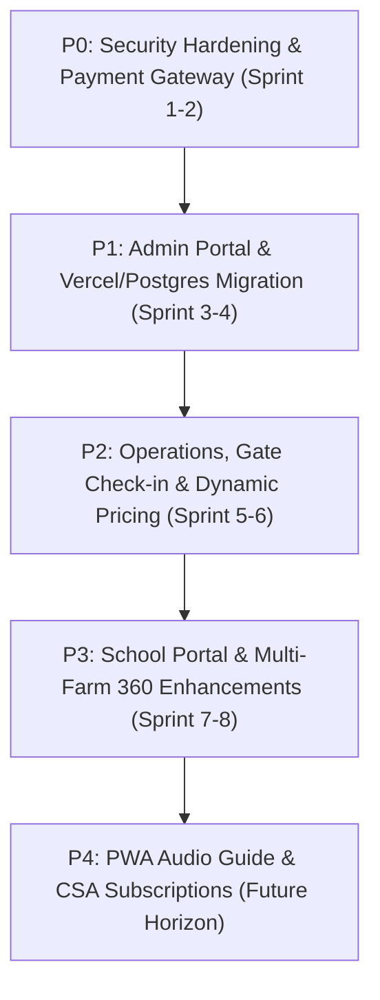

# One Day Kissan — Strategic Development Roadmap (P0 to P4)
**Document ID:** `ODK-AUDIT-06-ROADMAP`  
**Date:** November 2026  
**Author:** Technical Lead & Principal Solutions Architect  
**Scope:** Engineering Prioritization, Phased Implementation Sequence & Resource Allocation (Phase 8)  

---

## 1. Roadmap Architecture & Execution Principles

To ensure engineering efficiency, risk mitigation, and commercial readiness, development is organized into **five distinct tiers (P0 through P4)**. 

### Guiding Principles:
1. **Zero Public Launch Before P0:** Under no circumstances should marketing or paid campaigns commence while customer PII is publicly exposed (`GET /api/bookings`) or capacity is unconstrained.
2. **Decouple Admin from Public Code:** The administrative portal should be built with isolated routing and RBAC so farm managers can operate independently of frontend redesigns.
3. **Migrate to PostgreSQL Before High Traffic:** Vercel serverless deployment cannot safely run with SQLite; database migration must occur in P1 before scaling visitor acquisition.

---

## 2. Complete Engineering Prioritization Table

| Sequence | Feature / Initiative | Current Status | Business Value | Dependencies | Complexity | Priority |
| :---: | :--- | :---: | :--- | :--- | :---: | :---: |
| **01** | **Secure PII Endpoint (`GET /api/bookings`)** | 🔴 Critical Leak | Eliminates legal liability under Indian DPDP Act 2023; prevents customer data theft. | Express middleware | **Small** | **P0** |
| **02** | **API Rate Limiting & DoS Protection** | ❌ Missing | Prevents malicious server crashing and automated booking flooding. | `express-rate-limit` | **Small** | **P0** |
| **03** | **Enforce Strict Capacity Check & Concurrency** | ⚠️ Bypassed | Prevents farm overbooking (e.g. 715 guests booked on 300 capacity). | Atomic DB transaction | **Small** | **P0** |
| **04** | **Razorpay Payment Gateway Integration** | ❌ Mock Only | Automates 20% advance collection; converts high-intent traffic instantly. | Razorpay Node SDK | **Medium** | **P0** |
| **05** | **Cryptographic Booking Reference & QR Signatures** | ⚠️ Predictable | Prevents ticket enumeration and forgery at the farm gate. | Node `crypto` | **Small** | **P0** |
| **06** | **PostgreSQL Migration & Vercel Serverless Config** | ❌ Local SQLite | Enables horizontal scaling, zero maintenance, and 99.99% uptime on Vercel. | Neon / Supabase, Drizzle | **Large** | **P1** |
| **07** | **Admin Authentication & Role-Based Access Control** | ❌ Missing | Allows Farm Managers and Gate Security to log in safely. | JWT / HttpOnly cookie, bcrypt | **Medium** | **P1** |
| **08** | **Farm Manager Booking & Capacity Dashboard** | ❌ Missing | Staff can view daily arrival manifests, change dates, and close days. | Admin UI, REST endpoints | **Medium** | **P1** |
| **09** | **Mobile QR Gate Scanner Interface** | ❌ Missing | Eliminates gate bottlenecks; verifies tickets in <2 seconds. | HTML5 Camera scanner | **Small** | **P1** |
| **10** | **Automated WhatsApp Booking Confirmations** | ⚠️ Client link | Delivers official PDF passes and Google Map directions automatically. | Meta WhatsApp Cloud API | **Medium** | **P1** |
| **11** | **Gate Balance POS Collection Logger** | ❌ Missing | Guarantees collection of remaining 80% balance before farm entry. | Gate check-in API | **Small** | **P2** |
| **12** | **Dynamic Weekend vs Weekday Pricing Engine** | ⚠️ Flat rate | Maximizes peak Saturday/Sunday revenue; boosts empty weekday occupancy. | DB pricing rules | **Medium** | **P2** |
| **13** | **Self-Service Rescheduling & Cancellation Portal** | ❌ Missing | Cuts support phone calls by 70%; gives visitors confidence to book ahead. | Token auth, booking API | **Medium** | **P2** |
| **14** | **Dual-Farm 360° VR Tour Switcher (Bhongir/Moinabad)** | ⚠️ Single image | Clarifies landscape differences between Bhongir and Moinabad. | Second 360 equirectangular | **Small** | **P2** |
| **15** | **Dietary & Traditional Food Pre-Order In-Wizard** | ⚠️ Text box | Prevents farm kitchen food waste; ensures multi-generational meal satisfaction. | Wizard UI & DB schema | **Small** | **P2** |
| **16** | **School & Corporate Quotation Engine** | ❌ Missing | Speeds up school board purchase orders and corporate retreat bookings. | PDF generation engine | **Medium** | **P3** |
| **17** | **Farm-Fresh Harvest Basket Pre-Order** | ❌ Missing | Generates high-margin ancillary revenue (₹500–₹800 per booking). | Order line items | **Small** | **P3** |
| **18** | **Live Farm Weather & Attire Advisory Banner** | ❌ Missing | Prepares visitors for rain/red mud; reduces complaints. | Weather API | **Small** | **P3** |
| **19** | **Automated Post-Visit Review & NPS Harvester** | ❌ Missing | Drives dozens of verified 5-star Google Reviews every weekend. | Scheduled webhook | **Small** | **P3** |
| **20** | **Componentize Monolithic `index.html`** | ⚠️ 17k lines | Enables multi-developer frontend velocity without git merge conflicts. | Vite / React / Next.js | **Large** | **P3** |
| **21** | **Interactive Live Farm Map & GPS Audio Guide** | ❌ Missing | Allows self-guided exploration across paddy, cattle, and hearth stations. | PWA, Geolocation API | **Medium** | **P4** |
| **22** | **Seasonal Crop Subscription Passes (Kharif to Pongal)** | ❌ Missing | Builds recurring revenue and long-term customer community. | Multi-pass engine | **Medium** | **P4** |
| **23** | **Kids Farm Passport & Activity Stamp Gamification** | ❌ Missing | Engages school children deeply; creates viral social media bragging rights. | Canvas badge generator | **Small** | **P4** |
| **24** | **Interactive Deccan Soil & Crop Simulator** | ❌ Missing | Premium educational feature establishing agricultural thought leadership. | Canvas animation | **Medium** | **P4** |

---

## 3. Phased Implementation Sequence & Release Milestones

### Phase P0: Security Hardening & Transactional Core (Weeks 1 – 2)
- **Goal:** Neutralize critical legal/security liabilities and make bookings financially real.
- **Milestone Deliverables:**
  1. Remove unauthenticated `GET /api/bookings` route (SEC-01).
  2. Implement `express-rate-limit` on all API endpoints (SEC-03).
  3. Patch `createBooking()` with strict capacity enforcement and atomic transaction (SEC-04).
  4. Integrate Razorpay checkout for 20% advance deposit with webhook signature verification.
  5. Upgrade booking reference generation to `crypto.randomBytes` (SEC-06).
  6. Add `helmet` security headers and restrict CORS to production domain.

### Phase P1: Production Infrastructure & Operational Backbone (Weeks 3 – 5)
- **Goal:** Migrate to scalable serverless architecture and provide farm staff with operating tools.
- **Milestone Deliverables:**
  1. Set up Neon / Supabase PostgreSQL database; run migration script.
  2. Deploy Express API as Vercel Serverless Functions (`/api/*`).
  3. Offload static media (188 hero frames, 360 imagery) to Cloudflare R2 edge CDN.
  4. Build password-protected Admin Dashboard (`/admin`) with Farm Manager credentials.
  5. Build Mobile HTML5 QR Scanner for farm gate security.
  6. Integrate Meta WhatsApp Business Cloud API for automated ticket delivery.

### Phase P2: Commercial Optimization & Visitor Autonomy (Weeks 6 – 8)
- **Goal:** Maximize revenue per visitor and reduce manual operational overhead.
- **Milestone Deliverables:**
  1. Launch dynamic pricing (weekend premium / weekday discount).
  2. Deploy visitor self-service portal for date rescheduling.
  3. Deploy gate balance POS collection logger (reconciling cash & on-spot UPI).
  4. Add Moinabad 360° panorama scene toggle in Three.js viewer.
  5. Implement dietary meal preference selection in Step 2 of the booking wizard.

### Phase P3: Institutional Growth & Code Modernization (Weeks 9 – 12)
- **Goal:** Scale school/corporate pipelines and streamline code maintainability.
- **Milestone Deliverables:**
  1. Launch automated School & Corporate Quotation Engine with instant PDF generation.
  2. Launch farm-fresh harvest basket pre-orders during checkout.
  3. Deploy automated WhatsApp post-visit review and NPS collection engine.
  4. Refactor monolithic `index.html` into modular Vite/React or Next.js components.

### Phase P4: Experimental & Long-Term Community (Future Horizon)
- **Goal:** Continuous differentiation and community building.
- **Milestone Deliverables:**
  1. PWA Interactive Farm Map with GPS-guided audio narration.
  2. Annual Seasonal Crop Subscription Passes.
  3. Kids Farm Passport gamification.
