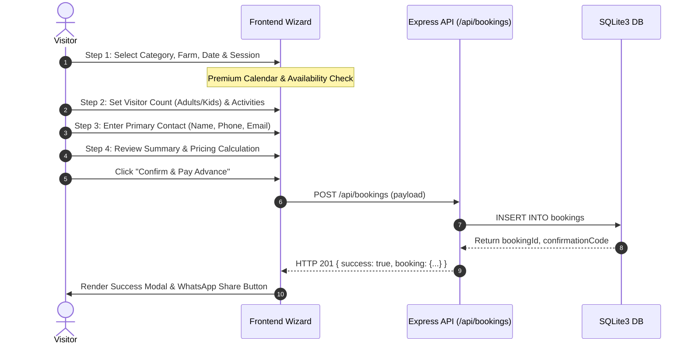

# One Day Kissan — Visitor Journey & Business Operations Gap Analysis
**Document ID:** `ODK-AUDIT-02-GAP-ANALYSIS`  
**Date:** November 2026  
**Auditor:** Principal Solutions Architect, Technical Lead, UX Auditor & Security Analyst  
**Status:** In-Depth Visitor Experience & Business Management Audit  

---

## Executive Summary

This document presents a granular gap analysis of the **One Day Kissan** agritourism platform across two critical dimensions:
1. **The Complete Visitor Journey (Phase 2):** From initial organic discovery, storytelling, and 360° virtual farm exploration to the interactive activity discovery, booking wizard, and mobile experience.
2. **Administrator and Farm Business Operations (Phase 3):** The internal operational capabilities required to manage reservations, visitors, sessions, blackout dates, gate check-in, revenue tracking, and staff workflows.

The platform exhibits an impressive, luxury aesthetic with high-fidelity frontend storytelling (188-frame canvas hero, Three.js 360° panorama, dynamic activity modals, multi-step booking wizard with a real interactive calendar). However, a profound asymmetry exists: **the visitor-facing experience is 80% polished, while the administrative and operational layer is currently 0% implemented**.

---

## 1. Phase 2 — Visitor-Facing Feature Audit


### A. Homepage and Discovery

| Component / Feature | Current Implementation Status | Code Location | Gap & UX Analysis |
| :--- | :--- | :--- | :--- |
| **Hero Section & Cinematic Animation** | **Fully Implemented** | `#hero`, [index.html](file:///home/ravikumaryarra5224/fcuk/index.html#L8248) | 188-frame canvas sequence (boys carrying paddy) at 24fps with ring buffer. **Gap:** Downloads ~15MB of images upfront; needs streaming WebP or AVIF video fallback for slower 3G connections. |
| **Navigation & Mobile Drawer** | **Fully Implemented** | `#siteHeader`, `#mobileDrawer`, [index.html](file:///home/ravikumaryarra5224/fcuk/index.html#L8170-L8245) | Glassmorphic sticky header, blur backdrop, hamburger toggle with smooth translate-x slideout. Tested across 320px–1920px. **Gap:** No breadcrumbs or sub-page navigation. |
| **About the Farm / Storytelling** | **Fully Implemented** | `#about`, `#storySection`, [index.html](file:///home/ravikumaryarra5224/fcuk/index.html#L8310-L8410) | Three-stage authentic storytelling: 01 Discover, 02 Participate, 03 Experience Rural Life. Custom editorial photography. Clear brand philosophy. |
| **Farm Locations (Bhongir & Moinabad)** | **Fully Implemented** | `#locations`, [index.html](file:///home/ravikumaryarra5224/fcuk/index.html#L8420-L8510) | Dedicated location comparison cards with soil types, driving distance, GPS map links, and "Plan Visit" direct action triggers. |
| **Experience Discovery** | **Fully Implemented** | `#activities`, [index.html](file:///home/ravikumaryarra5224/fcuk/index.html#L8520-L8700) | Displays 12 authentic rural activities categorized into 4 domains. Fetched dynamically via `/api/experiences` backed by `official_activities.json`. |
| **Activity Categories & Filters** | **Fully Implemented** | Filter bar, [index.html](file:///home/ravikumaryarra5224/fcuk/index.html#L8540-L8575) | Client-side tab filters: "All", "Farming & Crops", "Rural Traditions", "Livestock & Nature", "Culinary & Crafts". Instant animated DOM reflow. |
| **Photo & Lightbox Gallery** | **Fully Implemented** | `#gallerySection`, [index.html](file:///home/ravikumaryarra5224/fcuk/index.html#L8710-L8830) | Responsive 9-item mosaic grid loaded from `gallery_data.json` with modal lightbox, full-size zoom, keyboard navigation, and caption display. |
| **Testimonials & Social Proof** | **Partially Implemented** | `#testimonials`, [index.html](file:///home/ravikumaryarra5224/fcuk/index.html#L8840-L8950) | Video testimonial cards rendered from `testimonial_videos.json`. **Gap:** Video embed modal uses YouTube iframe placeholders; no native video player or verified Google Review badge integration. |
| **School Directory & Group Proof** | **Fully Implemented** | `#schoolsSection`, [index.html](file:///home/ravikumaryarra5224/fcuk/index.html#L8960-L9080) | Displays 10 premier Hyderabad schools (Oakridge, Chirec, DPS, etc.) with student headcount badges and educational curriculum alignment. |
| **FAQ Interactive Accordion** | **Fully Implemented** | `#faqSection`, [index.html](file:///home/ravikumaryarra5224/fcuk/index.html#L9090-L9210) | 8 comprehensive questions covering food, dress code, safety, weather, and transport. Smooth ARIA-accessible accordions. |
| **Direct Contact & WhatsApp CTAs** | **Fully Implemented** | Footer & Float CTAs, [index.html](file:///home/ravikumaryarra5224/fcuk/index.html#L9220-L9340) | Direct phone dialer (`tel:+919100033333`), WhatsApp direct chat trigger with pre-filled message, and Google Maps direction links. |

---

### B. Immersive Farm Experience (Three.js 360° Farm Tour)

| Dimension | Evaluation | Technical Analysis & Findings |
| :--- | :--- | :--- |
| **Three.js Sphere Panorama** | **Fully Implemented** | Uses Three.js r128 with inverted `SphereGeometry(500, 60, 40)` and `MeshBasicMaterial`. Loads `assets/360/village_farm_360.jpg` seamlessly. |
| **Navigation Hotspots** | **Fully Implemented** | CSS 2D / 3D projected raycasting pins for "Paddy Bunds", "Cattle Shed", "Clay Oven Hearth", and "Organic Orchard". Clicking pins pans camera. |
| **Camera Movement & Controls** | **Fully Implemented** | Orbit controls with damped inertia (`enableDamping: true`, damping factor `0.05`), auto-rotation toggle, pitch clamping (`-85°` to `+85°`) preventing pole singularities. |
| **Panorama Transitions** | **Partially Implemented** | Camera pans smoothly to hotspot targets, but scene transitions between different sub-farm locations (e.g. Moinabad vs Bhongir) are not implemented; uses a single shared equirectangular image. |
| **Device Gyroscope Support** | **Not Implemented** | No `DeviceOrientationControls` or WebXR API integration. Tilting a smartphone does not move the camera; user must drag with touch. |
| **Touch & Pinch-to-Zoom** | **Fully Implemented** | Smooth multi-touch gesture handling with FOV bounds clamped between `40°` and `90°`. |
| **Memory & Lifecycle Management** | **Fully Implemented** | Strict lifecycle management: WebGL context cleans up textures, geometries, and materials upon modal close. Scoped `IntersectionObserver` halts render loop when container is off-screen. |
| **Reduced-Motion Accessibility** | **Fully Implemented** | Automatically detects `prefers-reduced-motion: reduce`, disabling auto-rotation and substituting instant position snap for smooth panning. |

---

### C. Activity Discovery & Deep Exploration

```
+-------------------------------------------------------------------------+
| Activity Card (Listing)                                                 |
| [Image: Rice Paddy Planting]                                            |
| Title: Heirloom Rice Sowing & Transplantation                           |
| Badges: [Hands-on] [All Ages] [Bhongir & Moinabad] [Duration: 90 Mins]  |
| Price: Included in Farm Day Pass                                        |
| Button: [Explore Experience]  --> Opens Dynamic Modal                    |
+-------------------------------------------------------------------------+
                                    |
                                    v
+-------------------------------------------------------------------------+
| Dynamic Modal (Modal View)                                              |
| - High-res image gallery / video preview                                |
| - Full pedagogical description & cultural history                       |
| - Recommended Attire: Rubber boots / cotton clothes                     |
| - Farm-specific availability indicator                                  |
| - Quick action: [Book This Experience Now] -> Pre-fills Step 01 Wizard   |
+-------------------------------------------------------------------------+
```

1. **Activity Listings & Filtering:**
   - **Current:** 12 activities dynamically loaded from `official_activities.json` via `/api/experiences`. Filterable by 4 categories.
   - **Gap:** No search bar (e.g. searching "pottery" or "tractor"); no seasonal availability badges (e.g. "Kharif Monsoon Only", "Winter Harvest Only").
2. **Activity Details & Rich Content:**
   - **Current:** Dynamic modal opens with detailed agenda, what to bring, age guidelines, and safety gear.
   - **Gap:** No video clips inside activity modals (only static photos).
3. **Pricing & Inclusions:**
   - **Current:** Cards display "Included in Day Pass" or special workshop fee.
   - **Gap:** No breakdown of tax (GST 18%), lunch buffet inclusions, or optional add-ons (e.g. take-home organic vegetable basket).
4. **Farm-Specific Availability:**
   - **Current:** Activities display location badges ("Both Farms" or "Bhongir Only").
   - **Gap:** The booking wizard does not dynamically prune activities based on whether the user picks Bhongir vs Moinabad.

---

### D. Booking Wizard Experience

The booking wizard is the core transactional engine of the website. It is structured into 4 sequential steps inside `#bookingWizard` ([index.html](file:///home/ravikumaryarra5224/fcuk/index.html#L9350-L10200)):



#### Detailed Gap Audit of the 4 Booking Steps:

1. **Step 1 — Visit Type, Farm, Date Calendar & Session:**
   - **Visit Category:** 4 clear options (Day Outing, School Expedition, Corporate Offsite, Farming Enthusiast). Fully implemented with interactive radio cards.
   - **Farm Selection:** Main Farm (Bhongir) vs Branch Farm (Moinabad). Switching farms triggers calendar recalculation.
   - **Premium Date Calendar:**
     - Fully interactive custom component (replaces generic browser `<input type="date">`).
     - Deep forest green theme, warm ivory typography, harvest gold active selection.
     - Month/Year navigation, weekday header, correct month alignment.
     - Prevents past date selection; highlights "Today".
     - Real-time availability indicator via `/api/availability?farm=...&date=...`.
     - **Gap:** No price variance indicator on dates (e.g. highlighting peak weekend rates vs discounted weekday rates).
   - **Fixed Session Selection:**
     - Displays two fixed sessions: "Morning Harvest (09:00 AM – 03:30 PM)" and "Sunset Camp (02:30 PM – 08:30 PM)".
     - Live capacity counter (`Remaining Capacity: X slots`).
     - Disables session when capacity is exhausted.
2. **Step 2 — Group Composition & Activity Selection:**
   - Counter inputs for Adults (₹1,200), Children (₹800), and Infants (Free).
   - Multi-select checkbox cards for chosen farm activities.
   - **Gap:** Group size limit is arbitrarily capped at 50 in frontend; larger school groups (200–500 students) cannot use the standard wizard and must fall back to manual phone calls.
3. **Step 3 — Lead Guest Details & Special Requests:**
   - Name, phone number (10-digit regex validation), email address, school/organization name (conditional), dietary preference, and special requirements.
   - **Gap:** No OTP verification for Indian mobile numbers; users can enter fake phone numbers (`9999999999`).
4. **Step 4 — Review Summary & Commercial Commitment:**
   - Instant dynamic bill calculation: Adult total + Child total + GST (18%) + Advance deposit (20%).
   - Action: "Confirm Booking & Pay ₹X Advance".
   - **Gap 1 (Critical): Real Payment Gateway Absent.** Clicking the button creates a booking with status `confirmed` or `pending` without real Razorpay/PayU payment capture.
   - **Gap 2: No Self-Service Cancellation or Rescheduling.** Once booked, the visitor has no portal or link to change their date, cancel their visit, or download a tax invoice PDF.

---

### E. Mobile Experience & Responsive UX

| Audit Check | Status | Verification Detail |
| :--- | :--- | :--- |
| **Viewport & Scaling** | **Verified** | Standard `<meta name="viewport" content="width=device-width, initial-scale=1.0, maximum-scale=5.0">`. No pinch-zoom locking bugs. |
| **Navigation Drawer** | **Verified** | Slide-out drawer with backdrop scrim. Traps focus, closes on link click or `Escape` key. Tested on 390px (iPhone 14) and 320px (iPhone SE). |
| **Calendar Usability** | **Verified** | Date cells adapt smoothly using CSS grid (`grid-cols-7`). Minimum tap target size is `44px x 44px`, meeting WCAG AAA requirements. |
| **Wizard Stepper on Mobile** | **Verified** | Step headers collapse into a compact numbered progress bar on `<640px`. Inputs stack vertically with generous tap margins. |
| **Asset Overhead & Bandwidth** | **Partial Risk** | Hero canvas downloads 188 JPEG frames (~15MB total). On 4G/LTE mobile networks, this can exhaust visitor data. Needs WebP or responsive frame skipping. |
| **Form Virtual Keyboard Usability** | **Verified** | Numerical inputs use `inputmode="numeric"`, phone inputs use `type="tel"`, email inputs use `type="email"`, triggering appropriate mobile soft keyboards. |

---

## 2. Phase 3 — Administrator & Farm Business Management

The entire backend and frontend was audited to determine what operational tools exist for farm staff, managers, and owners.

### Summary Matrix: Administrator Capabilities

| Operational Domain | Status | Code Findings | Action Required |
| :--- | :---: | :--- | :--- |
| **Admin Authentication & RBAC** | ❌ **Missing** | Zero auth routes, no JWT/session middleware, no password hashing (`bcrypt` absent). | Build `/admin/login`, session cookies, roles (`Owner`, `Farm Manager`, `Gate Staff`). |
| **Operational Dashboard** | ❌ **Missing** | No analytics view, no daily arrivals counter, no revenue ticker. | Build web dashboard showing today's bookings, checked-in guests, pending balance. |
| **Booking Management (CRUD)** | ⚠️ **Incomplete** | Raw `GET /api/bookings` returns 50 bookings in JSON (unauthenticated). No UI exists to edit, approve, or cancel. | Build admin booking table with search, filters (date, farm, status), and status change buttons. |
| **Gate Check-in & QR Scanning** | ❌ **Missing** | No ticket QR generation, no gate scanner interface for farm security staff. | Generate secure signed QR codes in booking confirmation; build mobile-friendly QR scanner page. |
| **Capacity & Blackout Date Controls** | ⚠️ **Incomplete** | Hardcoded capacity in `database.js` (`farm_limits: 300 / 150`). No UI to block festival days or weather closures. | Add `blackout_dates` and `session_capacities` tables + admin calendar toggle interface. |
| **Payment Tracking & Balance Collection** | ❌ **Missing** | Advance deposit calculation is visual only. No record of cash/UPI collected at farm gate. | Track `advance_paid`, `balance_due`, `payment_method` (UPI, Cash, Card) at checkout/gate. |
| **Cancellation & Refund Automation** | ❌ **Missing** | No refund endpoints, no policy calculation (e.g. 100% refund >48h, 50% >24h). | Build automated cancellation workflow with Razorpay Refund API integration. |
| **Customer Enquiries & Leads** | ❌ **Missing** | Contact form submits directly to WhatsApp without logging customer inquiries into a database. | Add `enquiries` table to capture corporate and school leads for automated CRM follow-up. |
| **Automated Notifications (SMS/WhatsApp)** | ⚠️ **Incomplete** | Frontend constructs `https://wa.me/...` URL on client side. No server-side WhatsApp Business Cloud API. | Integrate Twilio or Gupshup / Meta WhatsApp Cloud API for automated booking confirmations and reminders. |
| **Staff Audit Logging** | ❌ **Missing** | No audit trail table. No record of who modified a booking or changed capacity limits. | Create `audit_logs` table tracking admin user ID, action, timestamp, and IP address. |

---

## 3. Detailed Operational Deficits & Workflows

### 1. The "Ghost Gate" Problem (Arrival & Check-in)
Currently, when a visitor books on the website:
1. A database record is created in SQLite.
2. The user is redirected to a WhatsApp window with their booking ID.
3. **At the Farm Gate:** The farm manager has no software interface to verify the ticket. There is no QR code reader, no guest manifest search, and no mechanism to mark the visitor as "Arrived" or "No-Show". Farm security must rely on reading the visitor's WhatsApp text.

### 2. Manual Capacity Overrides
Farms often host private corporate retreats or maintenance days (e.g. field plowing, deep irrigation). Currently, to mark a date as unavailable:
- A developer must manually SSH into the server and execute raw SQL statements against `onedaykissan.db`.
- Farm owners (non-technical) have no interface to declare: *"Close Bhongir farm next Tuesday for private event."*

### 3. Balance Collection Vulnerability
The booking wizard assumes a 20% advance deposit with 80% payable upon gate arrival. Because there is no check-in POS or cash collection logging:
- Gate staff have no system enforcing payment of the remaining 80% balance before entry.
- Discrepancies between booked visitor count (e.g. 5 adults) and actual arriving count (e.g. 8 adults) cannot be reconciled digitally.

---

## 4. Synthesis of Critical Gaps

```
+---------------------------------------------------------------------------------+
|                                 VISITOR EXPERIENCE                              |
| [Good] Luxury UI, 360 Panorama, Dynamic Modals, Glassmorphic Design, Fast Load  |
| [Gap]  No Online Payment Gateway, No Self-Service Portal, No SMS/Email Ticket  |
+---------------------------------------------------------------------------------+
                                         |
                                         v
+---------------------------------------------------------------------------------+
|                               FARM OPERATIONS & ADMIN                           |
| [Critical Gap] No Admin UI, No Staff Logins, No QR Gate Scanner,               |
|                No Blackout Date Manager, No Revenue Analytics, No CRM           |
+---------------------------------------------------------------------------------+
```

### Top 5 Strategic Gaps Requiring Immediate Resolution:
1. **Razorpay Payment Gateway Integration:** Replace mock advance payment with live UPI / Netbanking / Credit Card checkout.
2. **Admin Portal with Role-Based Access:** Build a password-protected admin dashboard for Farm Managers and Gate Attendants.
3. **QR Code Digital Ticket & Gate Scanner:** Issue cryptographically signed QR codes and provide a 1-tap mobile scanner for farm gate security.
4. **Dynamic Capacity & Blackout Date Calendar:** Allow managers to open/close dates and adjust morning/evening session caps in real time.
5. **Server-Side Automated WhatsApp & Email Engine:** Send official PDF tickets and Google Maps pins via Meta Cloud API or Twilio.
