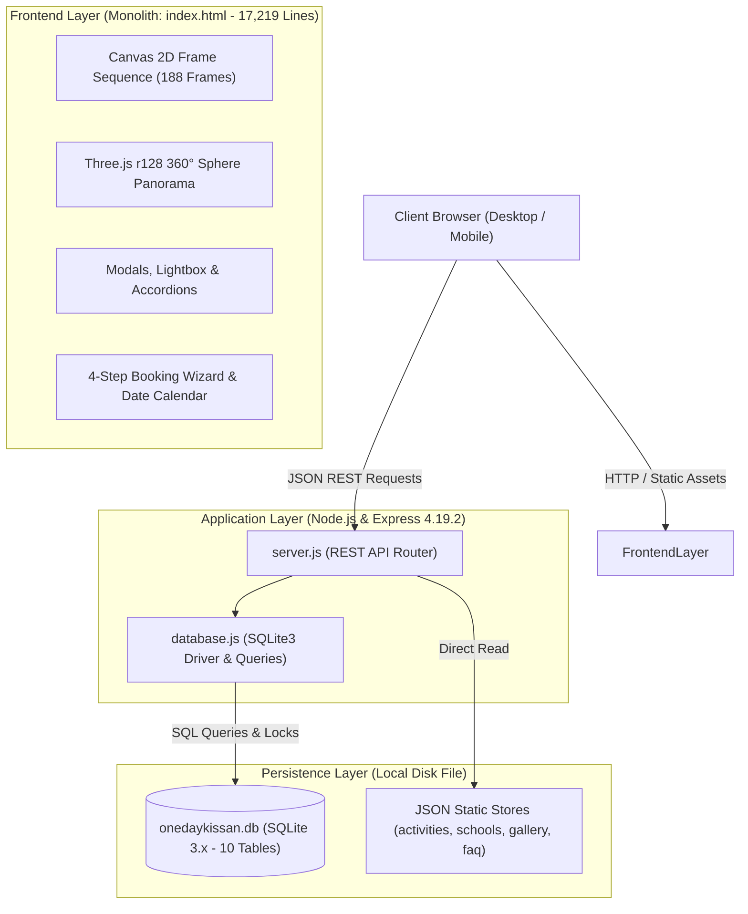
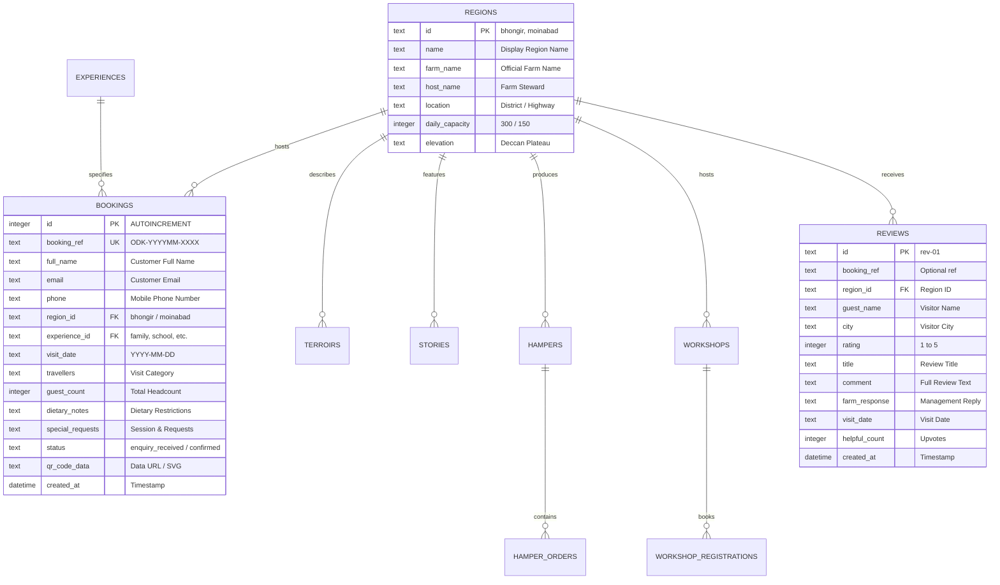
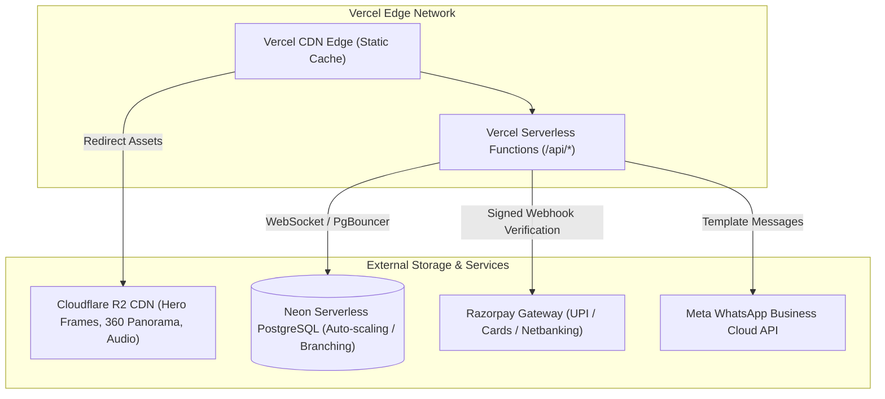

# One Day Kissan — System Architecture & Production Deployment Evaluation
**Document ID:** `ODK-AUDIT-04-ARCHITECTURE`  
**Date:** November 2026  
**Auditor:** Principal Solutions Architect & Technical Lead  
**Scope:** Full-Stack Architecture, Database Schema, API Inventory, Serverless Vercel Suitability & PostgreSQL Migration Roadmap  

---

## 1. Architectural Overview & System Topology

The One Day Kissan platform currently operates as a classic single-instance Node.js/Express monolith backed by a local SQLite file database and an expansive monolithic single-page frontend.



---

## 2. Technology Stack & Component Inventory

| Architectural Tier | Current Technology | Version | Production Assessment |
| :--- | :--- | :---: | :--- |
| **Runtime Environment** | Node.js | `>=18.0.0` | Production ready. |
| **Backend Framework** | Express | `4.19.2` | Production standard; lightweight REST API. |
| **Database Engine** | SQLite3 | `5.1.7` | ❌ **Unsuitable for production serverless**. Local file-locking contention. |
| **3D / WebGL Graphics** | Three.js | `r128` | Production ready; high-performance WebGL. |
| **CSS / Styling** | Tailwind CSS CDN | `3.x` | ⚠️ CDN script tag used; should be compiled via PostCSS for smaller production bundle. |
| **Icons** | Lucide Icons | `0.300+` | Clean modern iconography; inline SVG injection. |
| **QR Code Engine** | `qrcode` | `1.5.3` | Reliable, but synchronous generation blocks Node event loop under load. |
| **Static Assets** | Local filesystem (`assets/`) | — | High payload (~25MB); needs CDN edge delivery. |

---

## 3. Database Schema & Relational Structure

The database `onedaykissan.db` contains **10 tables** managed in [database.js](file:///home/ravikumaryarra5224/fcuk/database.js#L13-L525):



### Table Inventory & Status

| Table Name | Row Count | Primary Key | Foreign Keys | Operational Purpose / Status |
| :--- | :---: | :---: | :---: | :--- |
| `regions` | 6 | `id` (TEXT) | — | Active: Contains Bhongir & Moinabad (and 4 legacy demo regions). |
| `experiences` | 4 | `id` (TEXT) | — | Partially Active: Legacy experiences in SQLite table. |
| `bookings` | 19 | `id` (INT) | `region_id`, `experience_id` | **Active Core Transactional Table:** Stores customer reservations. |
| `terroirs` | 4 | `id` (TEXT) | `region_id` | Legacy: Agrarian soil and weather characteristics. |
| `stories` | 4 | `id` (TEXT) | `region_id` | Active: Farmer and village artisan oral histories. |
| `hampers` | 4 | `id` (TEXT) | `region_id` | ⚠️ **Dead/Orphaned:** USD-priced farm hamper catalogue. |
| `hamper_orders` | 3 | `id` (INT) | `hamper_id` | ⚠️ **Dead/Orphaned:** Hamper delivery orders. |
| `workshops` | 4 | `id` (TEXT) | `region_id` | ⚠️ **Dead/Orphaned:** USD-priced masterclasses. |
| `workshop_registrations` | 3 | `id` (INT) | `workshop_id` | ⚠️ **Dead/Orphaned:** Workshop ticket registrations. |
| `reviews` | 9 | `id` (TEXT) | `region_id` | Active: Visitor reviews and ratings. |

---

## 4. Complete REST API Endpoint Inventory

| HTTP Method | Route | Handler Location | Status / Usage | Response Payload |
| :--- | :--- | :--- | :---: | :--- |
| `GET` | `/api/health` | [server.js:38-42](file:///home/ravikumaryarra5224/fcuk/server.js#L38-L42) | Active | System health status and timestamp. |
| `GET` | `/api/regions` | [server.js:44-48](file:///home/ravikumaryarra5224/fcuk/server.js#L44-L48) | Active | List of all farm regions with capacities. |
| `GET` | `/api/experiences` (Route 1) | [server.js:50-57](file:///home/ravikumaryarra5224/fcuk/server.js#L50-L57) | **Active (Shadows Route 2)** | Queries `experiences` table from SQLite. |
| `GET` | `/api/experiences` (Route 2) | [server.js:145-155](file:///home/ravikumaryarra5224/fcuk/server.js#L145-L155) | ❌ **Shadowed Dead Code** | Express catches Route 1 first; this file-based route is unreachable. |
| `GET` | `/api/farm-stats` | [server.js:523-535](file:///home/ravikumaryarra5224/fcuk/server.js#L523-L535) | Active | Verified statistics (400+ schools, 4.9★ rating). |
| `GET` | `/api/availability` | [server.js:370-420](file:///home/ravikumaryarra5224/fcuk/server.js#L370-L420) | Active | Returns single date or full month availability map. |
| `POST` | `/api/bookings` | [server.js:425-485](file:///home/ravikumaryarra5224/fcuk/server.js#L425-L485) | **Active Core Endpoint** | Validates payload, inserts booking, returns QR code. |
| `GET` | `/api/bookings/:ref` | [server.js:487-499](file:///home/ravikumaryarra5224/fcuk/server.js#L487-L499) | Active | Looks up reservation pass by reference code. |
| `GET` | `/api/bookings` | [server.js:502-520](file:///home/ravikumaryarra5224/fcuk/server.js#L502-L520) | 🔴 **CRITICAL LEAK** | Returns recent 50 customer bookings without authentication. |
| `GET` | `/api/stories` | [server.js:210-230](file:///home/ravikumaryarra5224/fcuk/server.js#L210-L230) | Active | Audio & oral histories. |
| `GET` | `/api/stories/:id` | [server.js:235-245](file:///home/ravikumaryarra5224/fcuk/server.js#L235-L245) | Active | Single story with ambient audio path. |
| `GET` | `/api/reviews` | [server.js:320-340](file:///home/ravikumaryarra5224/fcuk/server.js#L320-L340) | Active | Guest reviews with farm steward replies. |
| `POST` | `/api/reviews` | [server.js:345-365](file:///home/ravikumaryarra5224/fcuk/server.js#L345-L365) | Active | Creates new guest review. |
| `GET` | `/api/hampers` | [server.js:160-175](file:///home/ravikumaryarra5224/fcuk/server.js#L160-L175) | ⚠️ Dead Code | Legacy USD hamper catalog. |
| `POST` | `/api/hamper-orders`| [server.js:180-205](file:///home/ravikumaryarra5224/fcuk/server.js#L180-L205) | ⚠️ Dead Code | Legacy hamper checkout. |
| `GET` | `/api/workshops` | [server.js:250-270](file:///home/ravikumaryarra5224/fcuk/server.js#L250-L270) | ⚠️ Dead Code | Legacy USD workshop catalog. |
| `POST` | `/api/workshops/register` | [server.js:275-300](file:///home/ravikumaryarra5224/fcuk/server.js#L275-L300) | ⚠️ Dead Code | Legacy workshop ticketing. |

---

## 5. Evaluation for Production Deployment on Vercel with PostgreSQL

```
+-----------------------------------------------------------------------------------+
|                        CAN CURRENT CODE DEPLOY TO VERCEL AS-IS?                   |
|                                       NO ❌                                       |
|  - SQLite disk writes are completely unsupported on serverless functions.         |
|  - Function container filesystem is ephemeral; writes are destroyed on cold start.|
|  - Server.js listens on persistent daemon port (app.listen(PORT)); Vercel uses    |
|    stateless handler exports (export default async function handler(req, res)).  |
+-----------------------------------------------------------------------------------+
```

### Critical Technical Incompatibilities with Vercel

1. **Ephemeral File System (The SQLite Blocker):**
   - Vercel functions execute in isolated AWS Lambda micro-VMs.
   - The filesystem is read-only except `/tmp` (500MB ephemeral storage).
   - If `onedaykissan.db` is bundled into the deployment, SQLite opens it in read-only mode. Any `INSERT INTO bookings` throws `SQLITE_READONLY`.
   - If copied to `/tmp`, different visitor requests hit different Lambda instances with separate `/tmp` directories, causing complete data fragmentation and data loss on container teardown.
2. **Serverless Connection Exhaustion with PostgreSQL:**
   - Standard PostgreSQL servers (e.g. AWS RDS or self-hosted) allocate 1 OS process per connection (default `max_connections = 100`).
   - If 300 simultaneous visitors load the site, 300 Vercel Lambdas spin up, instantly exhausting PostgreSQL connections (`FATAL: remaining connection slots are reserved for non-replication superuser connections`).
   - **Solution:** A serverless connection pooler is mandatory (Neon Serverless Driver over WebSocket, Supabase Connection Pooler via PgBouncer on port `6543`, or Prisma Accelerate).
3. **Asset Bandwidth & Free/Pro Tier Limits:**
   - The repository contains 188 cinematic hero frames (~15MB), Three.js 360 panorama (~3.5MB), and location photography.
   - Total site payload is ~25MB per fresh visitor.
   - Vercel's standard bandwidth quota is 100GB/month (Hobby) or 1TB/month (Pro).
   - Just **4,000 visitors** would exhaust the 100GB tier.
   - **Solution:** Offload `/assets/` to an external object store (Cloudflare R2 or AWS S3) served through Cloudflare CDN with zero egress fees.
4. **17,219-Line Monolithic Frontend:**
   - [index.html](file:///home/ravikumaryarra5224/fcuk/index.html) is 1.1MB of unminified HTML, inline scripts, and CSS.
   - High cognitive load for team maintenance; severe risk of regression during simultaneous feature development.

---

## 6. PostgreSQL Migration Architecture Plan



### PostgreSQL DDL Schema Migration (Draft)

```sql
-- PostgreSQL Production Schema for One Day Kissan
CREATE TABLE regions (
    id VARCHAR(50) PRIMARY KEY,
    name VARCHAR(100) NOT NULL,
    farm_name VARCHAR(150) NOT NULL,
    host_name VARCHAR(100) NOT NULL,
    location VARCHAR(200) NOT NULL,
    daily_capacity INTEGER DEFAULT 300,
    elevation VARCHAR(50) DEFAULT 'Deccan Plateau'
);

CREATE TABLE bookings (
    id BIGSERIAL PRIMARY KEY,
    booking_ref VARCHAR(32) UNIQUE NOT NULL,
    full_name VARCHAR(150) NOT NULL,
    email VARCHAR(150) NOT NULL,
    phone VARCHAR(20) NOT NULL,
    region_id VARCHAR(50) REFERENCES regions(id),
    visit_date DATE NOT NULL,
    session VARCHAR(50) NOT NULL, -- 'morning_harvest' or 'sunset_camp'
    adult_count INTEGER NOT NULL DEFAULT 1,
    child_count INTEGER NOT NULL DEFAULT 0,
    infant_count INTEGER NOT NULL DEFAULT 0,
    guest_count INTEGER NOT NULL,
    total_amount NUMERIC(10, 2) NOT NULL,
    advance_paid NUMERIC(10, 2) DEFAULT 0.00,
    balance_due NUMERIC(10, 2) NOT NULL,
    payment_status VARCHAR(30) DEFAULT 'unpaid', -- unpaid, advance_paid, fully_paid
    status VARCHAR(30) DEFAULT 'confirmed', -- confirmed, checked_in, cancelled, no_show
    dietary_notes TEXT,
    special_requests TEXT,
    qr_signature TEXT NOT NULL,
    created_at TIMESTAMPTZ DEFAULT CURRENT_TIMESTAMP
);

CREATE INDEX idx_bookings_date_region ON bookings(region_id, visit_date, session);
CREATE INDEX idx_bookings_phone ON bookings(phone);
```

---

## 7. Dead Code & Architectural Cleanup Inventory

1. **Shadowed Route Removal:** Remove line 145 in `server.js` (`app.get('/api/experiences')` reading JSON) or harmonize it with line 50.
2. **Decommission USD Legacy Tables:** Drop `hampers`, `hamper_orders`, `workshops`, and `workshop_registrations` from the active schema to eliminate dead tables.
3. **Harmonize Regions:** Remove legacy demo regions (`sahyadri`, `punjab`, `cauvery`, `himachal`) from `regions` table seed, retaining exclusively authentic Telangana locations (`bhongir`, `moinabad`).
