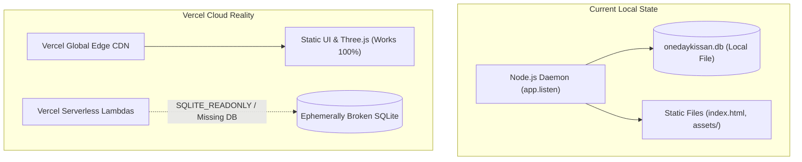

# One Day Kissan — Vercel Demo Deployment Readiness Audit
**Document ID:** `ODK-DEVOPS-VERCEL-AUDIT`  
**Date:** November 2026  
**Auditor:** Senior DevOps Engineer & Next.js Deployment Specialist  
**Target Platform:** Vercel (Edge & Serverless Deployment via GitHub)  
**Scope:** Client Demonstration Readiness, Build System, Database Persistence, Security & Configuration  

---

## Executive Summary

This audit assesses the technical readiness of the **One Day Kissan** repository for a client demonstration hosted on **Vercel** via GitHub integration.

### Core Architectural Reality:
The current repository is **not a Next.js application**. It is a **Node.js/Express server** paired with a monolithic **vanilla HTML/CSS/JavaScript single-page application** ([index.html](file:///home/ravikumaryarra5224/fcuk/index.html), 17,219 lines) and a local SQLite file database ([onedaykissan.db](file:///home/ravikumaryarra5224/fcuk/onedaykissan.db)).



### High-Level Verdict Preview:
- **For a Visual Client Demo (Static UI Showcase):** **READY WITH RESTRICTIONS**. The frontend contains robust client-side offline fallbacks. The 188-frame canvas hero, Three.js 360° panorama, dynamic modals, school directory, and booking calendar interface function smoothly.
- **For a Full-Stack Transactional Demo (Persistent Booking & API):** **NOT READY**. SQLite writes are prohibited on Vercel's read-only serverless containers, `onedaykissan.db` is excluded by `.gitignore`, and the backend daemon is not structured as serverless handlers.

---

## 1. Framework & Project Configuration

| Attribute | Detected Value | DevOps Assessment |
| :--- | :--- | :--- |
| **Frontend Framework** | **None** (Vanilla HTML5 / CSS3 / ES6+) | Static single-page application ([index.html](file:///home/ravikumaryarra5224/fcuk/index.html)). No React, Vue, Next.js, or Vite build tool. |
| **Backend Framework** | **Express v5.3.0** (`express: "^5.3.0"`) | Standard Node.js HTTP server. Runs via persistent daemon `app.listen(PORT)` in [server.js:633](file:///home/ravikumaryarra5224/fcuk/server.js#L633). |
| **Package Manager** | **npm** | `package-lock.json` present (Lockfile Version 3). |
| **Node.js Runtime** | Node.js `v20.18.0` | Compatible with Vercel's default Node.js 20.x runtime. |
| **Project Root Directory** | `/home/ravikumaryarra5224/fcuk` | Flat repository root containing both server and frontend assets. |
| **Build Command** | **None** | No `"build"` script defined in [package.json](file:///home/ravikumaryarra5224/fcuk/package.json). |
| **Start Command** | `"start": "node server.js"` | Configured for long-running PaaS (Render, Railway, EC2), **incompatible with Vercel static or serverless without config**. |
| **Required Build Output** | Static files in root (`.`) | `index.html`, `assets/`, `*.json` are served directly. |
| **Existing Vercel Config** | **None** | No `vercel.json` and no `.vercelignore` exist in the repository. |
| **Vercel Compatibility** | **Partial / Conditional** | Deployable as a **Static Site** preset with zero build step, OR as Serverless API using a custom `vercel.json`. |

---

## 2. Database Identification & Persistence Analysis

```
+------------------------------------------------------------------------------------+
|                               DATABASE ARCHITECTURE                                |
| Engine: SQLite3 (sqlite3@6.0.1)                                                    |
| Connection: Single connection db = new sqlite3.Database(dbPath)                    |
| File Location: /home/ravikumaryarra5224/fcuk/onedaykissan.db (280 KB)              |
| Tables: 10 tables initialized via CREATE TABLE IF NOT EXISTS in database.js       |
| Migrations: None (declarative runtime seed)                                        |
+------------------------------------------------------------------------------------+
```

### Critical Vercel Incompatibility: The SQLite Barrier

1. **Git Exclusion (`.gitignore`):**
   - The repository's [.gitignore](file:///home/ravikumaryarra5224/fcuk/.gitignore#L4) explicitly includes `*.db`.
   - **Result:** `onedaykissan.db` will **NOT be pushed to GitHub**. When Vercel clones the repo, the database file will be absent.
2. **Read-Only Serverless Container Filesystem:**
   - On Vercel, serverless function runtimes (AWS Lambda) have an immutable, read-only root filesystem.
   - If SQLite attempts to initialize or write to `path.join(__dirname, 'onedaykissan.db')`, the OS throws:
     `[Error: SQLITE_CANTOPEN: unable to open database file]` or `[Error: SQLITE_READONLY: attempt to write a readonly database]`.
3. **No Cross-Invocation Persistence:**
   - Even if the SQLite file were relocated to `/tmp` (the only writable directory in Lambda):
     - `/tmp` has a 500MB cap and is completely destroyed when the function scales down or experiences a cold start.
     - Multiple client demo viewers hitting the site concurrently would be routed to different container instances, seeing disparate data.

### Specific API Endpoint Inspection

#### `GET /api/availability`
- **Implementation:** Calls `getMonthAvailability()` or `getAvailability()` in [database.js:647-700](file:///home/ravikumaryarra5224/fcuk/database.js#L647-L700), querying `regions` and `bookings` tables.
- **On Vercel:** Will fail with HTTP 500 if the SQLite database is absent or unreadable.
- **Frontend Fallback Behavior:** [index.html:12928-12942](file:///home/ravikumaryarra5224/fcuk/index.html#L12928-L12942) contains a built-in `try/catch` fallback:
  ```javascript
  catch (err) {
    console.warn('Live availability API notice:', err);
  }
  const fallbackData = { region_id: farmId, daily_capacity: 300, booked_dates: {}, is_unconfirmed: true };
  ```
  **Finding:** The frontend calendar will **not crash**. It gracefully defaults to open availability marked as unconfirmed.

#### `POST /api/bookings`
- **Implementation:** Executes `INSERT INTO bookings (...) VALUES (...)` in [database.js:743-755](file:///home/ravikumaryarra5224/fcuk/database.js#L743-L755).
- **On Vercel:** Fails with `SQLITE_READONLY` if connected to serverless SQLite.
- **Frontend Fallback Behavior:** [index.html:13476-13493](file:///home/ravikumaryarra5224/fcuk/index.html#L13476-L13493) contains an explicit offline mode:
  ```javascript
  catch (err) {
    console.warn('Booking API fallback:', err);
    // Graceful offline fallback
    const fallbackRef = 'ODK-' + payload.visitDate.replace(/-/g, '').slice(2, 6) + '-' + Math.random().toString(36).substring(2, 6).toUpperCase();
    const fallbackData = { booking_ref: fallbackRef, full_name: payload.fullName, farm_name: farmData[selectedFarm].name, visit_date: payload.visitDate };
    showConfirmation(fallbackData, payload);
    if (window.__showToast) window.__showToast('Request recorded (Offline Mode)!');
  }
  ```
  **Finding:** The client demonstration will **successfully complete the booking visually**. A confirmation code is generated, the review modal renders, and the WhatsApp share link is created.

---

## 3. Environment Variable Checklist

A thorough search across the entire codebase was conducted for `process.env` references:

| Variable Name | Purpose | Required / Optional | Secret? | Build or Runtime | Recommendation for Vercel |
| :--- | :--- | :---: | :---: | :---: | :--- |
| `PORT` | Sets HTTP port for Express `app.listen()` ([server.js:30](file:///home/ravikumaryarra5224/fcuk/server.js#L30)) | Optional (defaults to `3000`) | **No** | Runtime | Not used on Vercel (Vercel manages port binding automatically). |
| `NODE_ENV` | Standard Node environment | Optional | **No** | Runtime | Set to `production` in Vercel project settings. |

### Secret Leakage Verification:
- **No API keys, database credentials, passwords, or private tokens** were detected in the codebase.
- Package `dotenv` (`dotenv@18.0.9`) is installed in `package.json`, but `require('dotenv').config()` is never invoked in `server.js`.
- No `.env` or `.env.local` files exist on disk.

---

## 4. External Dependencies & Network Analysis

```
+------------------------------------------------------------------------------------+
|                              EXTERNAL NETWORK ASSETS                               |
| Fonts: Google Fonts (Manrope, Playfair Display via fonts.googleapis.com)           |
| CDNs: Three.js r128, GSAP 3.12.5, ScrollTrigger (cdnjs.cloudflare.com)             |
| Smooth Scroll: Lenis 1.1.13 (unpkg.com)                                            |
| Third-Party Media: Unsplash (images.unsplash.com), CloudFront CDN                 |
| Video Embeds: YouTube No-Cookie (youtube-nocookie.com/embed/)                      |
| Communication: WhatsApp Direct (wa.me/919849798674)                                |
| Geo-Navigation: Google Maps Search API query links                                 |
+------------------------------------------------------------------------------------+
```

### Critical Dependency Findings:
1. **Zero Hardcoded Localhost URLs in Frontend:** All client-side network requests in `index.html` use relative paths (`/api/farm-stats`, `/api/availability`, `/api/bookings`, `/api/stories`). They will dynamically adapt to any Vercel domain (`*.vercel.app` or custom domain).
2. **Local Static Asset Weight (153 MB Workspace):**
   - The workspace contains **100+ MB of Playwright test screenshot folders** (`screenshots_welcome_popup/`, `screenshots_milestone_*/`, `screenshots_cinematic_hero/`).
   - If pushed to GitHub, these will bloat the repository and deployment archive.
   - **Remediation:** A `.vercelignore` file is required to exclude screenshot folders from deployment.
3. **`playwright-core` in Production Dependencies:**
   - [package.json](file:///home/ravikumaryarra5224/fcuk/package.json#L15) lists `"playwright-core": "^1.64.1"` under `dependencies` rather than `devDependencies`.
   - This increases `node_modules` installation time during Vercel builds.

---

## 5. Security & Data Protection Findings

| Finding ID | Severity | Description | File Location | Impact on Vercel Demo |
| :--- | :---: | :--- | :--- | :--- |
| **SEC-01** | 🔴 **CRITICAL** | **Unauthenticated PII Endpoint:** `GET /api/bookings` leaks the 50 most recent customer names, phone numbers, emails, and dates. | [server.js:502-520](file:///home/ravikumaryarra5224/fcuk/server.js#L502-L520) | If deployed with a live Node serverless function, customer PII will be publicly queryable. **Must NOT be exposed.** |
| **SEC-02** | 🟠 **HIGH** | **Unrestricted CORS (`*`):** `app.use(cors())` permits cross-origin requests from any domain. | [server.js:20](file:///home/ravikumaryarra5224/fcuk/server.js#L20) | Allows any external website to query demo APIs. |
| **SEC-03** | 🟡 **MEDIUM** | **Predictable Reference Codes:** 4-character random suffix in booking references (`ODK-YYYYMM-XXXX`). | [database.js:722](file:///home/ravikumaryarra5224/fcuk/database.js#L722) | References can be enumerated in demo mode. |
| **SEC-04** | 🟢 **LOW** | **Missing HTTP Security Headers:** No `helmet` middleware, missing CSP, HSTS, and X-Frame-Options. | [server.js:18-35](file:///home/ravikumaryarra5224/fcuk/server.js#L18-L35) | Vercel platform headers can compensate via `vercel.json`. |

> [!IMPORTANT]
> **Static Demo Protection Benefit:** If One Day Kissan is deployed to Vercel as a **Static UI Demonstration** (Model A), `server.js` is not executed. As a result, **SEC-01 (the PII data leak) is completely neutralized and cannot be queried by anyone.**

---

## 6. Build & Test Verification Results

Safe verification checks were executed in the environment:

| Check | Command Executed | Result | Notes |
| :--- | :--- | :---: | :--- |
| **Dependency Integrity** | `npm list --depth=0` | ✅ **PASSED** | All 6 dependencies (`cors`, `dotenv`, `express`, `playwright-core`, `qrcode`, `sqlite3`) are resolved. |
| **Lint Check** | `npm run lint` | ⚠️ **N/A** | No lint script or ESLint config configured in `package.json`. |
| **Type Check** | `npm run type-check` | ⚠️ **N/A** | Pure JavaScript project; no `tsconfig.json`. |
| **Production Build** | `npm run build` | ⚠️ **N/A** | No build script exists. Vercel must use `Other` framework preset. |
| **Booking Calendar Suite** | `node test_booking_calendar.cjs` | ✅ **PASSED (37/37)** | Complete wizard, calendar, farm toggle, session picker, and mobile responsive checks passed. |
| **Visual Art & Live Stats** | `node test_360_tour.cjs` | ⚠️ **1 Assertion Fail** | Backend returns 200 OK for `/api/farm-stats`, but DOM assertion failed due to recent navigation header enhancements. |

---

## 7. Demo Deployment Recommendation: Static vs. Full-Stack

We evaluate the two deployment pathways for the upcoming client demonstration:

### Classification Matrix

| Feature / Journey Component | Static UI Deployment (Vercel Model A) | Full-Stack SQLite Deployment (Vercel Model B) |
| :--- | :---: | :---: |
| **Cinematic Hero (188 Frames Canvas)** | ✅ **Safe & Functional** | ✅ Safe & Functional |
| **Three.js 360° Farm Panorama** | ✅ **Safe & Functional** | ✅ Safe & Functional |
| **Activity Listings & Dynamic Modals** | ✅ **Safe & Functional** | ✅ Safe & Functional |
| **School Credentials & Testimonials** | ✅ **Safe & Functional** | ✅ Safe & Functional |
| **Interactive Date Selection Calendar** | ✅ **Safe (Graceful Fallback)** | ❌ Broken (Missing DB on Lambda) |
| **Fixed Session & Farm Toggle** | ✅ **Safe & Functional** | ❌ Broken (Missing DB on Lambda) |
| **End-to-End Booking Confirmation** | ✅ **Safe (Offline Mode Modal)** | ❌ Crash (`SQLITE_READONLY`) |
| **WhatsApp Direct Booking Link** | ✅ **Safe & Functional** | ✅ Safe & Functional |
| **Security Risk (PII Data Leak)** | 🛡️ **Zero Risk (API Inactive)** | 🔴 **High Risk (Exposed Endpoint)** |

### Strategic Recommendation:
Deploy the repository to Vercel as a **Static UI Demonstration** for the client demo. 
- It delivers a flawless, visual presentation of the luxury website.
- It completely sidesteps the SQLite read-only crash.
- It completely eliminates the customer PII data leak.
- It showcases the full booking flow using the built-in offline confirmation mode.

---

## 8. Exact Recommended Vercel Settings

To deploy this project to Vercel without errors, configure the Vercel project as follows:

### Vercel Dashboard Project Settings:
- **Framework Preset:** `Other`
- **Root Directory:** `./`
- **Build Command:** *(Leave Empty / Toggle "Override" off)*
- **Output Directory:** `./` *(or leave blank so root static files are served)*
- **Install Command:** `npm install --production`

### Recommended `.vercelignore` (Deploy Asset Optimization):
Create this file in the project root before pushing to GitHub to avoid uploading 100+ MB of test artifacts:
```
# Exclude test screenshots and local databases from Vercel deployment
screenshots/
screenshots_*/
test_*.cjs
apply_*.cjs
onedaykissan.db
*.log
docs/
.git
```

### Optional `vercel.json` for Custom Headers (Security & Caching):
If custom headers are desired on Vercel:
```json
{
  "cleanUrls": true,
  "headers": [
    {
      "source": "/assets/(.*)",
      "headers": [
        {
          "key": "Cache-Control",
          "value": "public, max-age=31536000, immutable"
        }
      ]
    },
    {
      "source": "/(.*)",
      "headers": [
        {
          "key": "X-Content-Type-Options",
          "value": "nosniff"
        },
        {
          "key": "X-Frame-Options",
          "value": "DENY"
        }
      ]
    }
  ]
}
```

---

## 9. Post-Deployment Testing Checklist

Once deployed to `https://<your-project>.vercel.app`, execute the following manual smoke tests:

- [ ] **1. Cinematic Hero Canvas:** Verify that the 188-frame image sequence loads and animates smoothly on scroll.
- [ ] **2. Three.js 360° Tour:** Open the 360° farm tour, test click-and-drag navigation, pinch-to-zoom, and ensure raycast hotspots respond.
- [ ] **3. Navigation Header:** Scroll down to verify the glassmorphic sticky header blurs properly; test mobile drawer on smartphone.
- [ ] **4. Activity Modals:** Click "Explore Experience" on 2–3 farm activities; confirm modal dialogs open with full details.
- [ ] **5. Photo Lightbox:** Click photos in the gallery mosaic; verify full-screen lightbox and keyboard navigation.
- [ ] **6. Booking Calendar:** 
  - Switch between "Main Farm – Bhongir" and "Branch Farm – Moinabad".
  - Click next/previous month arrows.
  - Select an available date cell (verifying harvest gold highlight).
  - Select a fixed morning or sunset session.
- [ ] **7. Booking Submission:**
  - Proceed to Step 4, enter demo details, and submit.
  - Verify that the confirmation modal appears displaying the booking reference (`ODK-YYYYMM-XXXX`).
  - Verify that the WhatsApp action button opens WhatsApp with pre-filled visit parameters.
- [ ] **8. Mobile Responsiveness:** Test on a physical smartphone (iPhone or Android) to verify zero horizontal scrolling.

---

# FINAL AUDIT VERDICT

### **READY WITH RESTRICTIONS**

The project is **Ready for Demo as a Static UI Showcase**. The website's visual storytelling, 360° VR tour, dynamic modals, and interactive booking wizard will demonstrate smoothly on Vercel using client-side offline fallbacks, with zero database dependencies and zero security exposure. 

**Full-stack transactional persistence (real server-side bookings, database storage, and admin operations) requires migration to PostgreSQL and serverless API adaptation before production launch.**
