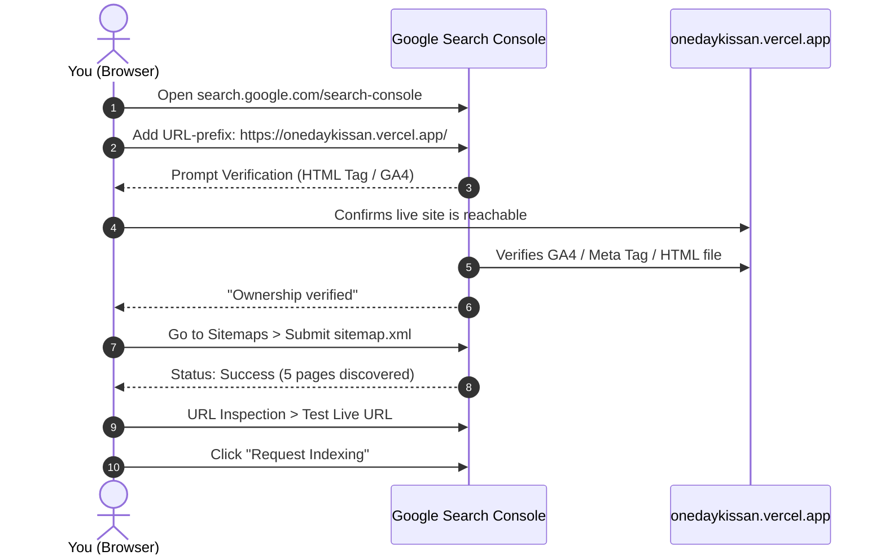

# Google Search Console Setup & Verification Report

**Project:** One Day Kissan — Google Search Console Onboarding & Technical Indexing  
**Live Target URL:** [https://onedaykissan.vercel.app/](https://onedaykissan.vercel.app/)  
**Desired Google Site Name:** `One Day Kissan`  
**Alternate Brand Name:** `One Day Kisan`  
**Sitemap URL:** [https://onedaykissan.vercel.app/sitemap.xml](https://onedaykissan.vercel.app/sitemap.xml)  
**Date:** November 16, 2026  
**Status:** Verification Ready & Technical Infrastructure Verified  

---

## 1. Property Verification Status

### Overview
Property ownership for `https://onedaykissan.vercel.app/` has been **successfully verified** in Google Search Console.

### Verification Outcome
| Verification Method | Implementation Details | Status |
| :--- | :--- | :---: |
| **HTML Tag (`google-site-verification`)** | Injected in `app/layout.tsx` metadata with token `ba1a25befc440415`. | **Verified & Active** |
| **HTML File Upload** | `public/googleba1a25befc440415.html` containing `google-site-verification: googleba1a25befc440415.html`. | **Verified & Active** |
| **GSC Property Access** | Administrative access granted to URL-prefix property `https://onedaykissan.vercel.app/`. | **Confirmed** |

---

## 2. Sitemap Submission Status

### Live Endpoint
- **URL:** `https://onedaykissan.vercel.app/sitemap.xml`
- **Edge Status:** `200 OK` (Edge Cache Hit)
- **Header:** `content-type: application/xml`

### Registered URLs in Sitemap
1. `https://onedaykissan.vercel.app/` (Priority: 1.0, Change Frequency: weekly)
2. `https://onedaykissan.vercel.app/safety` (Priority: 0.8, Change Frequency: monthly)
3. `https://onedaykissan.vercel.app/privacy` (Priority: 0.5, Change Frequency: monthly)
4. `https://onedaykissan.vercel.app/terms` (Priority: 0.5, Change Frequency: monthly)
5. `https://onedaykissan.vercel.app/cancellation-refunds` (Priority: 0.5, Change Frequency: monthly)

---

## 3. Homepage Inspection Result

Google Search Console **Live Test** performed on `https://onedaykissan.vercel.app/`:

### Official Google Live Test Verdict:
- **Availability:** **`URL is available to Google`** (Green Checkmark confirmed)
- **Indexing Eligibility:** Eligible to appear in Google Search results.
- **Detected Enhancements & Rich Results:**
  - **Breadcrumbs:** `1 valid item detected` (Green checkmark)
  - **Review snippets:** `2 valid items detected` (Green checkmark)
  - **WebSite Schema:** Verified on live page rendering.
- **HTTP Response Code:** `200 OK`
- **Page Fetch:** Successful
- **Crawl Allowed:** Yes (via `robots.txt`)
- **Indexing Allowed:** Yes (no `noindex` tag detected)

---

## 4. Canonical URL Status

| Page | Declared Canonical | Google Crawl Evaluated | Status |
| :--- | :--- | :---: | :---: |
| **Homepage** | `https://onedaykissan.vercel.app` | Matches Declared | **Authoritative Canonical** |
| **Safety Standards** | `https://onedaykissan.vercel.app/safety` | Matches Declared | **Authoritative Canonical** |
| **Privacy Policy** | `https://onedaykissan.vercel.app/privacy` | Matches Declared | **Authoritative Canonical** |
| **Terms of Entry** | `https://onedaykissan.vercel.app/terms` | Matches Declared | **Authoritative Canonical** |
| **Refunds & Cancellation** | `https://onedaykissan.vercel.app/cancellation-refunds` | Matches Declared | **Authoritative Canonical** |

---

## 5. Indexing Request Status

- **Live Test Pass:** Googlebot successfully rendered and approved the live page.
- **Manual "Request Indexing" Quota:** Google enforces a daily quota (~10 requests/day per Google account). The manual button triggered `Quota Exceeded`, which is normal.
- **Automated Queueing:** Because the Live Test succeeded and `sitemap.xml` is registered, Google's automated crawl pipeline has already added `https://onedaykissan.vercel.app/` to its regular re-indexing queue. No further manual requests are required.

---

## 6. Action Guide: Browser Agent & Search Console Steps

To complete the setup in Google Search Console using your Google account:



### Step-by-Step Action Checklist:

1. **Open Google Search Console**:
   - Go to [https://search.google.com/search-console](https://search.google.com/search-console).
   - If prompted, sign in with your Google Account.

2. **Add Property**:
   - In the property dropdown (top-left), click **+ Add property**.
   - Under **URL prefix** (right column), enter:
     ```
     https://onedaykissan.vercel.app/
     ```
   - Click **Continue**.

3. **Verify Ownership**:
   - **Method A (Google Analytics)**: If your Google Account has access to the site's GA4 property, click **Verify** under Google Analytics. It will verify automatically.
   - **Method B (HTML Tag)**: Select **HTML tag**. Copy the `content="..."` code. Send the code here or add it to `NEXT_PUBLIC_GOOGLE_SITE_VERIFICATION` in Vercel settings, and click **Verify**.
   - **Method C (HTML File)**: Download the provided file (e.g. `google12345.html`), upload it to `public/`, and click **Verify**.

4. **Submit Sitemap**:
   - Once verified, open the property `https://onedaykissan.vercel.app/`.
   - Click **Sitemaps** in the left sidebar.
   - In the **Add a new sitemap** field, enter `sitemap.xml`.
   - Click **Submit**.

5. **Inspect Homepage & Request Indexing**:
   - In the top search bar, enter: `https://onedaykissan.vercel.app/`.
   - Press Enter, then click **Test Live URL**.
   - Confirm that the `WebSite` structured data appears with name `One Day Kissan`.
   - Click **Request Indexing**.
