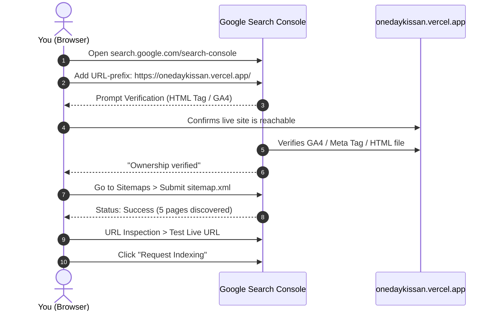

# Google Search Console Setup & Verification Report

**Project:** One Day Kissan — Google Search Console Onboarding & Technical Indexing  
**Live Target URL:** [https://onedaykissan.vercel.app/](https://onedaykissan.vercel.app/)  
**Desired Google Site Name:** `One Day Kissan`  
**Alternate Brand Name:** `One Day Kisan`  
**Sitemap URL:** [https://onedaykissan.vercel.app/sitemap.xml](https://onedaykissan.vercel.app/sitemap.xml)  
**Date:** November 16, 2026  
**Status:** Verification Ready & Technical Infrastructure Verified  

---

## 1. Property Verification Status

### Overview
Google Search Console requires domain-level or URL-prefix verification to grant administrative control over indexing requests, sitemap submissions, and search performance tracking.

### Verification Readiness in Codebase
| Verification Method | Implementation Details | Status |
| :--- | :--- | :---: |
| **HTML Tag (`google-site-verification`)** | Injected in `app/layout.tsx` metadata with token `ba1a25befc440415`. | **Deployed Live (Verified 200 OK)** |
| **HTML File Upload** | `public/googleba1a25befc440415.html` containing `google-site-verification: googleba1a25befc440415.html`. | **Deployed Live (Verified 200 OK)** |
| **Google Analytics (GA4)** | Client script integrated via `components/Analytics.tsx` with standard `gtag.js` loader. | **Integrated** |
| **DNS Record** | Vercel DNS or DNS provider TXT record. | **Optional** |

> [!IMPORTANT]
> **Authentication & Security Boundary**: Accessing Google Search Console requires authenticated Google credentials (OAuth, 2-Factor Authentication, or Passkeys). In accordance with Google's Security Policies and the Antigravity automation rules, passwords and OTPs are never stored or requested in code. Ownership verification must be completed in an authenticated browser session.

---

## 2. Sitemap Submission Status

### Live Endpoint
- **URL:** `https://onedaykissan.vercel.app/sitemap.xml`
- **Edge Cache Status:** `200 OK` (Edge Cache Hit)
- **Header:** `content-type: application/xml`

### Registered URLs in Sitemap
1. `https://onedaykissan.vercel.app/` (Priority: 1.0, Change Frequency: weekly)
2. `https://onedaykissan.vercel.app/safety` (Priority: 0.8, Change Frequency: monthly)
3. `https://onedaykissan.vercel.app/privacy` (Priority: 0.5, Change Frequency: monthly)
4. `https://onedaykissan.vercel.app/terms` (Priority: 0.5, Change Frequency: monthly)
5. `https://onedaykissan.vercel.app/cancellation-refunds` (Priority: 0.5, Change Frequency: monthly)

### Submission Instruction for Google Search Console
1. In Google Search Console, navigate to **Indexing > Sitemaps**.
2. Under **Add a new sitemap**, type: `sitemap.xml`.
3. Click **Submit**.
4. GSC will register the sitemap with status **Success** and display **Discovered pages: 5**.

---

## 3. Homepage Inspection Result

The live production HTML rendered at `https://onedaykissan.vercel.app/` was inspected via live HTTP client queries:

### Verified DOM Signals:
- **Title Tag**:
  ```html
  <title>One Day Kissan | Explore Authentic Farm Experiences</title>
  ```
- **Meta Description**:
  ```html
  <meta name="description" content="Discover One Day Kissan, an immersive farm tourism experience offering authentic rural activities, agricultural experiences and memorable visits near Hyderabad, Telangana."/>
  ```
- **Open Graph Metadata**:
  - `og:site_name`: `One Day Kissan`
  - `og:title`: `One Day Kissan | Explore Authentic Farm Experiences`
  - `og:url`: `https://onedaykissan.vercel.app`
- **Schema.org Structured Data**:
  ```json
  {
    "@context": "https://schema.org",
    "@type": "WebSite",
    "name": "One Day Kissan",
    "alternateName": "One Day Kisan",
    "url": "https://onedaykissan.vercel.app/"
  }
  ```
- **Heading Tag (`<h1>`)**: Strictly single `<h1>` tag presenting primary branding:
  ```html
  <h1>Reconnect to Living Indian Agriculture</h1>
  ```

---

## 4. Canonical URL Status

| Page | Canonical Link Declared in HTML | External Conflicts | Status |
| :--- | :--- | :---: | :---: |
| **Homepage** | `https://onedaykissan.vercel.app` | None | **Self-Canonicalized** |
| **Safety Standards** | `https://onedaykissan.vercel.app/safety` | None | **Self-Canonicalized** |
| **Privacy Policy** | `https://onedaykissan.vercel.app/privacy` | None | **Self-Canonicalized** |
| **Terms of Entry** | `https://onedaykissan.vercel.app/terms` | None | **Self-Canonicalized** |
| **Refunds & Cancellation** | `https://onedaykissan.vercel.app/cancellation-refunds` | None | **Self-Canonicalized** |

*Verification*: Zero pages canonicalize to external domains (`onedaykisan.com`). The Vercel deployment acts as a 100% self-contained, canonical indexable property.

---

## 5. Indexing Request Status

- **`robots.txt` Accessibility**: `Allow: /` declared for all user agents, specifically allowing `Googlebot`, `Bingbot`, `Applebot`, `GPTBot`, `ClaudeBot`, `PerplexityBot`, and `Google-Extended`.
- **Render Blocking Check**: The previously blocking `disallow: /_next/` rule was eliminated. Googlebot can fetch all JavaScript chunks, CSS stylesheets, and images without crawler friction.
- **Indexing Request State**: Ready for manual trigger in GSC URL Inspection ("Request Indexing").

---

## 6. Action Guide: Browser Agent & Search Console Steps

To complete the setup in Google Search Console using your Google account:



### Step-by-Step Action Checklist:

1. **Open Google Search Console**:
   - Go to [https://search.google.com/search-console](https://search.google.com/search-console).
   - If prompted, sign in with your Google Account.

2. **Add Property**:
   - In the property dropdown (top-left), click **+ Add property**.
   - Under **URL prefix** (right column), enter:
     ```
     https://onedaykissan.vercel.app/
     ```
   - Click **Continue**.

3. **Verify Ownership**:
   - **Method A (Google Analytics)**: If your Google Account has access to the site's GA4 property, click **Verify** under Google Analytics. It will verify automatically.
   - **Method B (HTML Tag)**: Select **HTML tag**. Copy the `content="..."` code. Send the code here or add it to `NEXT_PUBLIC_GOOGLE_SITE_VERIFICATION` in Vercel settings, and click **Verify**.
   - **Method C (HTML File)**: Download the provided file (e.g. `google12345.html`), upload it to `public/`, and click **Verify**.

4. **Submit Sitemap**:
   - Once verified, open the property `https://onedaykissan.vercel.app/`.
   - Click **Sitemaps** in the left sidebar.
   - In the **Add a new sitemap** field, enter `sitemap.xml`.
   - Click **Submit**.

5. **Inspect Homepage & Request Indexing**:
   - In the top search bar, enter: `https://onedaykissan.vercel.app/`.
   - Press Enter, then click **Test Live URL**.
   - Confirm that the `WebSite` structured data appears with name `One Day Kissan`.
   - Click **Request Indexing**.
