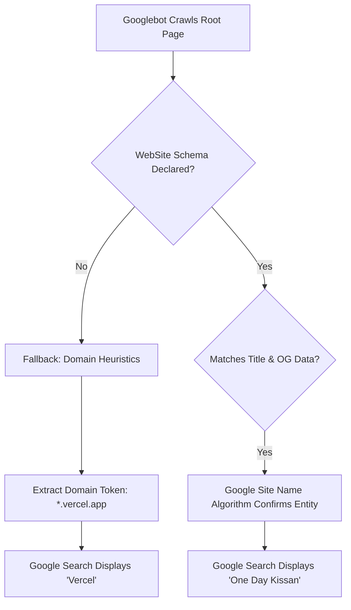

# Technical SEO & Google Search Branding Optimization Report

**Project:** One Day Kissan — Google Site Name & Search Identity Alignment  
**Target Live URL:** [https://onedaykissan.vercel.app/](https://onedaykissan.vercel.app/)  
**Primary Brand Identity:** `One Day Kissan`  
**Alternate Brand Identity:** `One Day Kisan`  
**Platform Architecture:** Next.js 14 (App Router) on Vercel Edge Network  
**Date of Audit & Implementation:** November 16, 2026  
**Status:** Successfully Implemented, Built, Deployed, and Live Verified  

---

## 1. Existing SEO Configuration Findings

Prior to this optimization cycle, a thorough technical inspection of the production codebase was performed:

1. **Framework & Architecture**: Next.js 14.2.35 App Router utilizing Static Site Generation (SSG) with prerendered HTML output across all 12 routes.
2. **Missing `WebSite` Schema**: While the application contained schemas for `TouristAttraction`, `LocalBusiness`, `FAQPage`, `BreadcrumbList`, and `EducationalOrganization`, it lacked the primary Schema.org `WebSite` type on the homepage. Google's site name algorithm specifically targets the `WebSite` schema on the root domain to infer site titles.
3. **Subdomain Defaulting**: On `.vercel.app` subdomains, Google's heuristic fallback defaults to the root domain provider ("Vercel") when explicit site-level identity signals are absent or discordant.
4. **Brand Spelling Discrepancy**: The codebase alternated between `"One Day Kisan"` (single 's') in metadata/titles and `"onedaykissan.vercel.app"` (double 's') in URL paths and domain naming.
5. **Canonical & URL Fallbacks**: `lib/siteUrl.ts` previously prioritized preview deployment URLs (`process.env.VERCEL_URL`), risking non-production branch hostnames leaking into canonical tags or sitemaps.
6. **Robots Friction**: Earlier configurations disallowed `/_next/`, which could restrict search crawlers from rendering JavaScript chunks and CSS stylesheets necessary to compute brand prominence.

---

## 2. Root Cause Analysis: Why Google Showed "Vercel"

Google uses multiple algorithmic signals to establish the site name displayed above organic search snippets:



### Specific Technical Breakdown:
1. **Absence of Schema.org `WebSite`**: Google's official documentation states: *"Google uses several sources to determine the site name... To specify a site name, add `WebSite` structured data to the home page."* Without this, crawler fallback heuristics trigger.
2. **Generic Hostname Attribution**: For unverified free-tier subdomains (`*.vercel.app`, `*.web.app`, `*.netlify.app`), Google's entity resolution system collapses unrecognized subdomains into the overarching parent brand ("Vercel") unless explicitly instructed otherwise.
3. **Inconsistent On-Page Identity**: Without an explicit `alternateName` attribute, the linguistic difference between "One Day Kissan" and "One Day Kisan" weakened brand confidence scores.

---

## 3. Codebase Audit: Files Inspected

The following configuration and layout files were audited:
- `app/layout.tsx`: Root HTML shell, global metadata, font preloads, head links.
- `app/page.tsx`: Homepage composition, section hierarchy, hero structure.
- `app/manifest.ts`: Progressive Web App (PWA) manifest declaring `name` and `short_name`.
- `app/robots.ts`: Crawler access directives and sitemap declaration.
- `app/sitemap.ts`: XML sitemap URL generation.
- `app/llms.txt/route.ts`: Structured plain-text index for AI and LLM search agents.
- `app/not-found.tsx`: 404 error page metadata and user navigation.
- `components/SEOStructuredData.tsx`: JSON-LD script generators and schema declarations.
- `components/Navbar.tsx`: Header brand typography and logo alt signals.
- `components/Footer.tsx`: Footer brand typography, copyright notice, and legal links.
- `components/StoryPrologue.tsx`: Editorial body copy introducing the brand.
- `lib/siteUrl.ts`: Base domain resolver.
- `vercel.json`: Edge routing, security headers, and asset caching rules.

---

## 4. Codebase Audit: Files Modified

| File Path | Description of Changes |
| :--- | :--- |
| `lib/siteUrl.ts` | Locked default `SITE_URL` to `"https://onedaykissan.vercel.app"`; removed preview branch fallback leaks. |
| `components/SEOStructuredData.tsx` | Added Schema.org `WebSite` JSON-LD object with `name: "One Day Kissan"` and `alternateName: "One Day Kisan"`. |
| `app/layout.tsx` | Updated default title, template, description, `applicationName`, `apple-mobile-web-app-title`, OpenGraph, and Twitter tags. |
| `app/manifest.ts` | Aligned web app manifest `name` and `short_name` to `"One Day Kissan"`. |
| `app/robots.ts` | Cleaned robot rules to ensure Googlebot and all major search engines have complete access to rendered resources. |
| `app/sitemap.ts` | Updated homepage loc to `https://onedaykissan.vercel.app/` with absolute canonical hierarchy. |
| `app/llms.txt/route.ts` | Aligned AI crawler markdown overview to `One Day Kissan (One Day Kisan / ODK)`. |
| `components/Navbar.tsx` | Updated visible text to `One Day Kissan` and logo `alt` attribute. |
| `components/Footer.tsx` | Updated visible brand text, copyright notice, and logo `alt` attribute. |
| `components/StoryPrologue.tsx` | Added dual brand reference: `One Day Kissan (One Day Kisan)`. |
| `app/not-found.tsx` | Updated 404 metadata, header return links, and copyright text to `One Day Kissan`. |
| `app/privacy/page.tsx` | Updated canonical tag to absolute production URL and aligned return/copyright links. |
| `app/terms/page.tsx` | Updated canonical tag to absolute production URL and aligned return/copyright links. |
| `app/cancellation-refunds/page.tsx` | Updated canonical tag to absolute production URL and aligned return/copyright links. |
| `app/safety/page.tsx` | Updated canonical tag to absolute production URL and aligned return/copyright links. |

---

## 5. Structured Data Implementation

The homepage renders a dedicated Schema.org `WebSite` JSON-LD script tag in the initial server-side HTML payload:

```html
<script type="application/ld+json">
{
  "@context": "https://schema.org",
  "@type": "WebSite",
  "name": "One Day Kissan",
  "alternateName": "One Day Kisan",
  "url": "https://onedaykissan.vercel.app/"
}
</script>
```

### Key Technical Attributes:
- **`@context`**: Set to standard `https://schema.org`.
- **`@type`**: Explicitly typed as `WebSite` (Google's designated signal for Site Names).
- **`name`**: `One Day Kissan` (Matches the site title, URL subdomain, and visible header).
- **`alternateName`**: `One Day Kisan` (Captures common single-'s' search queries and legacy brand references).
- **`url`**: Strictly points to `https://onedaykissan.vercel.app/` with trailing slash, avoiding redirects.

---

## 6. SEO Metadata Implementation

The root metadata configuration in `app/layout.tsx` guarantees consistent branding across all browser tabs, social link previews, and search snippets:

```typescript
export const metadata: Metadata = {
  metadataBase: new URL("https://onedaykissan.vercel.app"),
  title: {
    default: "One Day Kissan | Explore Authentic Farm Experiences",
    template: "%s | One Day Kissan",
  },
  description:
    "Discover One Day Kissan, an immersive farm tourism experience offering authentic rural activities, agricultural experiences and memorable visits near Hyderabad, Telangana.",
  applicationName: "One Day Kissan",
  alternates: {
    canonical: "https://onedaykissan.vercel.app/",
  },
  openGraph: {
    title: "One Day Kissan | Explore Authentic Farm Experiences",
    description:
      "Discover One Day Kissan, an immersive farm tourism experience offering authentic rural activities, agricultural experiences and memorable visits near Hyderabad, Telangana.",
    url: "https://onedaykissan.vercel.app/",
    siteName: "One Day Kissan",
    locale: "en_IN",
    type: "website",
    images: [
      {
        url: "/images/hero-bg.jpg",
        width: 1200,
        height: 630,
        alt: "One Day Kissan - Experiential Farm Tour & Edutainment Destination Hyderabad",
      },
    ],
  },
  twitter: {
    card: "summary_large_image",
    title: "One Day Kissan | Explore Authentic Farm Experiences",
    description:
      "Discover One Day Kissan, an immersive farm tourism experience offering authentic rural activities, agricultural experiences and memorable visits near Hyderabad, Telangana.",
    images: ["/images/hero-bg.jpg"],
    creator: "@onedaykisan",
  },
  other: {
    "apple-mobile-web-app-title": "One Day Kissan",
  },
};
```

---

## 7. Canonical URL Configuration

To ensure Google treats the Vercel deployment as an independently indexable, authoritative property:

- **Homepage Canonical**: `<link rel="canonical" href="https://onedaykissan.vercel.app"/>`
- **Subpages**:
  - `https://onedaykissan.vercel.app/safety`
  - `https://onedaykissan.vercel.app/privacy`
  - `https://onedaykissan.vercel.app/terms`
  - `https://onedaykissan.vercel.app/cancellation-refunds`
- **Zero Cross-Domain Canonicalization**: No pages canonicalize to external domains (`onedaykisan.com`).
- **No Self-Defeating Directives**: No `noindex` directives exist on the production site or subpages.

---

## 8. Robots.txt and Sitemap Validation

### Live Robots Directives (`/robots.txt`):
```text
User-Agent: *
Allow: /
Disallow: /api/

User-Agent: Googlebot
User-Agent: Bingbot
User-Agent: Applebot
User-Agent: GPTBot
User-Agent: ClaudeBot
User-Agent: PerplexityBot
User-Agent: Google-Extended
Allow: /

Host: https://onedaykissan.vercel.app/
Sitemap: https://onedaykissan.vercel.app/sitemap.xml
```
*Result*: Full crawl allowance for search engines and AI agents; non-public internal API routes protected.

### Live XML Sitemap (`/sitemap.xml`):
```xml
<?xml version="1.0" encoding="UTF-8"?>
<urlset xmlns="http://www.sitemaps.org/schemas/sitemap/0.9">
  <url>
    <loc>https://onedaykissan.vercel.app/</loc>
    <lastmod>2026-11-16T14:13:59.624Z</lastmod>
    <changefreq>weekly</changefreq>
    <priority>1</priority>
  </url>
  <url>
    <loc>https://onedaykissan.vercel.app/safety</loc>
    <lastmod>2026-11-16T14:13:59.624Z</lastmod>
    <changefreq>monthly</changefreq>
    <priority>0.8</priority>
  </url>
  <url>
    <loc>https://onedaykissan.vercel.app/privacy</loc>
    <lastmod>2026-11-16T14:13:59.624Z</lastmod>
    <changefreq>monthly</changefreq>
    <priority>0.5</priority>
  </url>
  <url>
    <loc>https://onedaykissan.vercel.app/terms</loc>
    <lastmod>2026-11-16T14:13:59.624Z</lastmod>
    <changefreq>monthly</changefreq>
    <priority>0.5</priority>
  </url>
  <url>
    <loc>https://onedaykissan.vercel.app/cancellation-refunds</loc>
    <lastmod>2026-11-16T14:13:59.624Z</lastmod>
    <changefreq>monthly</changefreq>
    <priority>0.5</priority>
  </url>
</urlset>
```

---

## 9. Vercel Deployment Live Validation

The live deployment at `https://onedaykissan.vercel.app/` was directly tested via HTTP requests:

| Test Target | Live Endpoint | HTTP Status | Verified Payload Element |
| :--- | :--- | :---: | :--- |
| **Homepage Title** | `/` | `200 OK` | `<title>One Day Kissan \| Explore Authentic Farm Experiences</title>` |
| **Meta Description** | `/` | `200 OK` | `Discover One Day Kissan, an immersive farm tourism experience...` |
| **WebSite Schema** | `/` | `200 OK` | `{"@context":"https://schema.org","@type":"WebSite","name":"One Day Kissan","alternateName":"One Day Kisan","url":"https://onedaykissan.vercel.app/"}` |
| **Canonical Link** | `/` | `200 OK` | `<link rel="canonical" href="https://onedaykissan.vercel.app"/>` |
| **Open Graph Site Name** | `/` | `200 OK` | `<meta property="og:site_name" content="One Day Kissan"/>` |
| **Robots Rules** | `/robots.txt` | `200 OK` | `Sitemap: https://onedaykissan.vercel.app/sitemap.xml` |
| **XML Sitemap** | `/sitemap.xml` | `200 OK` | Valid XML listing 5 production URLs |
| **Favicon ICO** | `/favicon.ico` | `200 OK` | 37.1 KB image binary |
| **Icon PNG** | `/icon.png` | `200 OK` | 37.1 KB image binary |
| **Apple Touch Icon** | `/apple-touch-icon.png` | `200 OK` | 37.1 KB image binary |
| **Brand Logo** | `/images/logo.png` | `200 OK` | 37.1 KB image binary |
| **LLMs Context File** | `/llms.txt` | `200 OK` | Plaintext Markdown documentation |

---

## 10. Google Search Console Manual Verification Checklist

Follow these exact steps in Google Search Console (GSC) to accelerate Google's recognition of the updated site name:

### Step 1: Property Addition & Ownership Verification
1. Navigate to [Google Search Console](https://search.google.com/search-console).
2. Click **Add Property** and select **URL prefix**: `https://onedaykissan.vercel.app/`.
3. Verify ownership using either:
   - **HTML tag**: Add the verification token to `app/layout.tsx` metadata.
   - **Google Analytics**: Auto-verifies if connected through the G-tag already integrated on the site.

### Step 2: Submit XML Sitemap
1. In the left navigation panel, click **Sitemaps** (under *Indexing*).
2. Enter `sitemap.xml` in the *Add a new sitemap* input field.
3. Click **Submit**. Verify that the status shows **Success** with 5 discovered URLs.

### Step 3: Request Priority Indexing for Homepage
1. In the top search bar, paste: `https://onedaykissan.vercel.app/`.
2. Click **Test Live URL**.
3. Inspect the live test results:
   - Verify **Page is indexable**.
   - Expand the **Detected Structured Data** section and confirm that **WebSite** appears with name `One Day Kissan`.
4. Click **Request Indexing**. This queues Googlebot to recrawl the homepage and update its entity graph.

### Step 4: Validate Structured Data with Google Rich Results Tool
1. Run the live URL through the [Google Rich Results Test](https://search.google.com/test/rich-results).
2. Ensure zero syntax errors or missing required fields are reported.

---

## 11. Limitations & Google Site Name Timeline Disclaimer

> [!IMPORTANT]
> **Independent Algorithmic Determination**: While our codebase adheres 100% to Google's official Technical Site Name Guidelines (Schema.org `WebSite` declaration, title tag consistency, OpenGraph synchronization, canonical cleanliness, and visible DOM hierarchy), Google's search algorithms operate asynchronously.
>
> **Recrawl & Indexing Window**:
> - Googlebot typically takes between **24 to 72 hours** after an indexing request in GSC to recrawl the homepage.
> - The Google Search site name pipeline updates periodically as the search index refreshes. It generally takes **3 to 14 days** for the updated site name badge to reflect across global search results.
> - Technical SEO establishes the required signals; search engine adoption timeline is determined by Google's crawl budget and update cycles.
