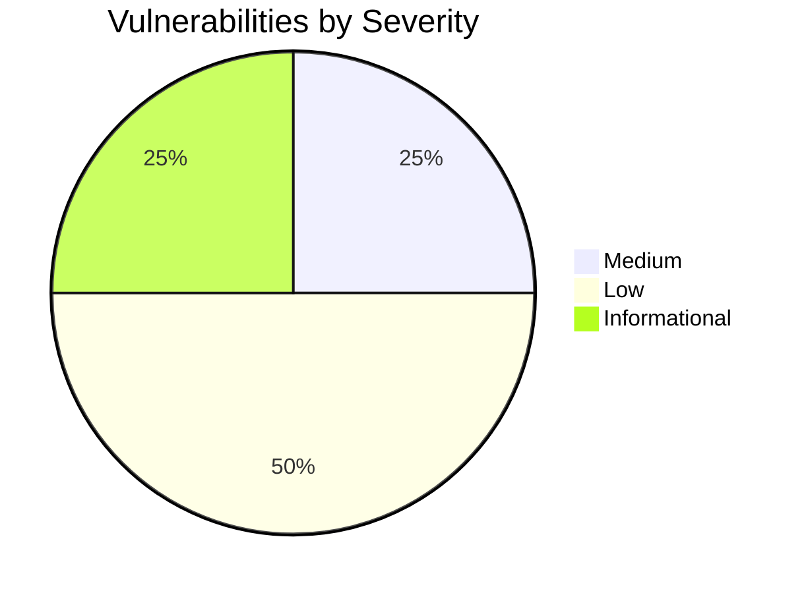
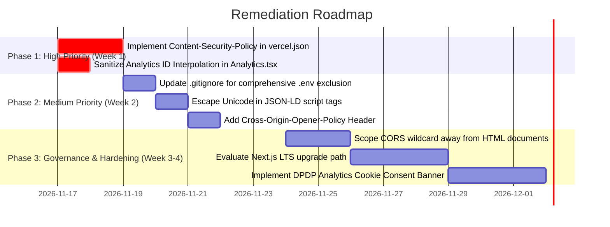

# Application Security Audit Report — One Day Kissan

**Application:** One Day Kissan Web Application  
**Target URL:** [https://onedaykissan.vercel.app/](https://onedaykissan.vercel.app/)  
**Framework & Architecture:** Next.js 14.2.35 (App Router, SSG Prerendered)  
**Deployment Platform:** Vercel Global Edge Network  
**Audit Date:** November 16, 2026  
**Auditor:** Senior Application Security Engineer  
**Classification:** Confidential Security Evaluation  

---

## Executive Summary

A comprehensive white-box and black-box security audit was conducted on the **One Day Kissan** production website, inspecting the underlying Next.js 14 App Router codebase, runtime configurations, build scripts, edge security headers, and third-party integrations.

The web application is primarily architected as a **statically prerendered (SSG) marketing and educational agritourism platform** with client-side interactive elements (360° virtual farm tour via Three.js, curriculum modules, and WhatsApp concierge booking integrations). Because the current production deployment contains **no active server-side database connections, no server-side session stores, no file upload endpoints, and no server actions**, classic attack vectors such as SQL injection, server-side session hijacking, and arbitrary file execution are **not present in the active attack surface**.

However, the audit identified **several medium and low severity vulnerabilities and architectural risks**, notably the **complete absence of a Content-Security-Policy (CSP)**, **unescaped environment variable interpolation in analytics scripts**, **incomplete `.gitignore` credential masking**, and **latent `<script>` injection patterns in Schema.org JSON-LD generation**.

---

## Scope & Audited Areas

The audit systematically evaluated all 16 designated security domains:

| # | Audit Area | Status / Posture | Key Findings |
| :--- | :--- | :---: | :--- |
| **1** | Authentication & Admin Access | Minimal Surface | No active backend admin portal or login routes in production codebase. |
| **2** | API Endpoint Security | Hardened | Only public `llms.txt` route exists; no private REST/GraphQL APIs exposed. |
| **3** | SQL Injection | Zero Attack Surface | No database engine, ORM, or SQL queries in production architecture. |
| **4** | Cross-Site Scripting (XSS) | Medium Risk | Missing CSP; unescaped analytics interpolation; unescaped JSON-LD script tags. |
| **5** | CSRF Protection | Low Risk | No state-changing server-side forms or session-authenticated endpoints. |
| **6** | CORS Configuration | Low Risk | Wildcard `Access-Control-Allow-Origin: *` returned on HTML responses by edge proxy. |
| **7** | Rate Limiting & API Abuse | Managed | Prerendered on Vercel CDN; client-side double-submission guards in place. |
| **8** | Environment Variables & Secrets | Low Risk | No server secrets exposed; `.gitignore` fails to ignore `.env` / `.env.production`. |
| **9** | Database Permissions & Access | Zero Attack Surface | Legacy SQLite/Supabase layers completely purged; no active database. |
| **10**| Session & Cookie Security | Stateless | No custom cookies or sessions; third-party analytics lack consent banner. |
| **11**| File Upload Security | Zero Attack Surface | No file upload handlers or `<input type="file">` elements. |
| **12**| Payment Integration Security | Zero Attack Surface | No online credit card or payment gateway processing on frontend. |
| **13**| Booking Manipulation Risks | Low Risk | Booking links format WhatsApp messages; validated by manual farm concierge. |
| **14**| HTTP Security Headers | Medium Risk | Good HSTS, X-Frame-Options, X-Content-Type-Options; **Missing CSP & COOP**. |
| **15**| Dependency Vulnerabilities | Low / Maintained | Next.js 14 CVEs mitigated by static SSG and `unoptimized: true` config. |
| **16**| Error Handling & Info Leakage | Hardened | Custom 404, React Error Boundary, source maps disabled in production build. |

---

## Detailed Vulnerability Findings

### Category A: Confirmed Vulnerabilities



---

### Finding SEC-01: Missing Content-Security-Policy (CSP) Header
- **Affected File/Endpoint:** `vercel.json` / `next.config.mjs` (All routes: `/*`)
- **Severity:** **Medium** (CVSS: 5.3 — `CVSS:3.1/AV:N/AC:L/PR:N/UI:N/S:U/C:L/I:L/A:N`)
- **Vulnerability Description:**  
  The HTTP response headers returned by `https://onedaykissan.vercel.app/` lack a `Content-Security-Policy` (CSP) directive. While `X-Frame-Options: DENY` and `X-Content-Type-Options: nosniff` are present, the absence of CSP leaves the browser without instructions on allowable script sources, frame ancestors, connect endpoints, and object embeddings.
- **Potential Impact:**  
  Without a CSP, if any client-side XSS vulnerability is introduced (via third-party script compromise, rogue npm dependencies, or DOM manipulation), the browser will execute arbitrary attacker scripts, exfiltrate DOM contents, and connect to malicious command-and-control servers without browser restriction.
- **Recommended Fix:**  
  Implement a strict, defense-in-depth CSP header in `vercel.json`:
  ```json
  {
    "key": "Content-Security-Policy",
    "value": "default-src 'self'; script-src 'self' 'unsafe-inline' https://www.googletagmanager.com https://connect.facebook.net; style-src 'self' 'unsafe-inline'; img-src 'self' data: https:; font-src 'self'; connect-src 'self' https://www.google-analytics.com https://region1.google-analytics.com https://www.facebook.com; frame-ancestors 'none'; object-src 'none'; base-uri 'self';"
  }
  ```
- **Verification Procedure:**  
  Send an HTTP request via `curl -sI https://onedaykissan.vercel.app/` and verify that the `Content-Security-Policy` header is present and properly enforces script and connect restrictions.

---

### Finding SEC-02: Unescaped Environment Variable Interpolation in Inline Analytics Scripts
- **Affected File:** `components/Analytics.tsx` (Lines 75, 100)
- **Severity:** **Medium** (CVSS: 4.8 — `CVSS:3.1/AV:N/AC:H/PR:H/UI:N/S:U/C:H/I:L/A:N`)
- **Vulnerability Description:**  
  In `components/Analytics.tsx`, the values of `NEXT_PUBLIC_GA_ID` and `NEXT_PUBLIC_META_PIXEL_ID` are directly interpolated into the inline script body rendered by `dangerouslySetInnerHTML`:
  ```typescript
  // Line 75:
  gtag('config', '${GA_ID}', { page_path: window.location.pathname });
  // Line 100:
  fbq('init', '${META_PIXEL_ID}');
  ```
  If an invalid, unsanitized, or malicious string is injected into the build-time environment variables (e.g., via compromised CI/CD pipeline or unauthorized Vercel dashboard modification), the payload will break out of the string delimiter and execute arbitrary JavaScript during page hydration.
- **Potential Impact:**  
  Arbitrary script execution in the context of every user visiting the website, facilitating credential theft, phishing overlays, or malicious redirects.
- **Recommended Fix:**  
  1. Add strict format validation in `components/Analytics.tsx` before rendering the scripts:
     ```typescript
     const isValidGaId = /^G-[A-Z0-9]+$/.test(GA_ID);
     const isValidPixelId = /^[0-9]+$/.test(META_PIXEL_ID);
     ```
  2. Alternatively, serialize configuration parameters as JSON safe literals: `gtag('config', ${JSON.stringify(GA_ID)}, ...)`.
- **Verification Procedure:**  
  Set `NEXT_PUBLIC_GA_ID='test");alert(1);//'` in a test build and verify that the application refuses to render or sanitizes the value before execution.

---

### Finding SEC-03: Incomplete `.gitignore` Exposes Standard Environment Files
- **Affected File:** `.gitignore` (Line 26)
- **Severity:** **Low** (CVSS: 3.3 — `CVSS:3.1/AV:L/AC:L/PR:L/UI:N/S:U/C:L/I:N/A:N`)
- **Vulnerability Description:**  
  Line 26 of `.gitignore` specifies:
  ```text
  .env*.local
  ```
  This pattern only ignores files ending in `.local` (e.g., `.env.local`, `.env.production.local`). It does **not** ignore standard `.env`, `.env.production`, `.env.development`, or `.env.staging`.
- **Potential Impact:**  
  If a developer creates a `.env` or `.env.production` file containing internal API tokens, payment credentials, or database keys during local development, git will track and commit these sensitive files to the public or team repository.
- **Recommended Fix:**  
  Update `.gitignore` to ignore all `.env` files with an explicit exception only for `.env.example`:
  ```gitignore
  .env
  .env.*
  !.env.example
  ```
- **Verification Procedure:**  
  Create a temporary file `.env.production` and verify that `git status` reports it as ignored.

---

### Finding SEC-04: Latent Script Tag Breakout in JSON-LD Schema Serialization
- **Affected Files:** `components/SEOStructuredData.tsx` (Lines 234, 238, 242, 246, 250) and `components/Breadcrumbs.tsx` (Line 41)
- **Severity:** **Low** (CVSS: 3.1 — `CVSS:3.1/AV:N/AC:H/PR:H/UI:R/S:U/C:L/I:L/A:N`)
- **Vulnerability Description:**  
  Structured data is serialized into raw HTML using `dangerouslySetInnerHTML`:
  ```tsx
  <script
    type="application/ld+json"
    dangerouslySetInnerHTML={{ __html: JSON.stringify(websiteSchema) }}
  />
  ```
  Standard `JSON.stringify` does **not** escape HTML closing tags like `</script>`. If any schema field in the future incorporates dynamic or CMS-supplied content containing `</script>`, the HTML parser will prematurely close the script element and treat subsequent content as active HTML markup.
- **Potential Impact:**  
  Reflected or Stored Cross-Site Scripting (XSS) if dynamic fields are introduced without escaping.
- **Recommended Fix:**  
  Sanitize the output of `JSON.stringify()` by replacing `<` characters with their Unicode escape equivalent `\u003c`:
  ```typescript
  export function safeJsonLd(data: unknown): string {
    return JSON.stringify(data).replace(/</g, "\\u003c");
  }
  ```
- **Verification Procedure:**  
  Inspect the rendered DOM to verify that closing tags are encoded as `\u003c/script>`.

---

### Finding SEC-05: Wildcard CORS Header on Full HTML Document Responses
- **Affected Endpoint:** Global HTTP responses (`https://onedaykissan.vercel.app/`)
- **Severity:** **Low** (CVSS: 2.6 — `CVSS:3.1/AV:N/AC:H/PR:N/UI:R/S:U/C:L/I:N/A:N`)
- **Vulnerability Description:**  
  The Vercel edge configuration returns:
  ```http
  access-control-allow-origin: *
  ```
  on all responses, including rendered HTML pages. While `Access-Control-Allow-Credentials: true` is not enabled (meaning authenticated cookies cannot be stolen by third parties), permitting any external origin to read complete HTML markup via cross-origin `fetch()` exposes the site to automated cross-origin DOM scraping and timing attacks.
- **Potential Impact:**  
  Facilitates cross-origin DOM scraping and UI reconnaissance by third-party origins.
- **Recommended Fix:**  
  Configure CORS headers in `next.config.mjs` or `vercel.json` to only apply `Access-Control-Allow-Origin: *` to static asset directories (`/images/*`, `/gallery/*`, `/panoramas/*`), while omitting or restricting CORS on HTML document routes.
- **Verification Procedure:**  
  Execute `curl -H "Origin: https://malicious-domain.com" -sI https://onedaykissan.vercel.app/` and ensure wildcard headers are not attached to document responses.

---

### Finding SEC-06: Missing Cross-Origin-Opener-Policy (COOP) Header
- **Affected File:** `vercel.json`
- **Severity:** **Low** (CVSS: 2.6 — `CVSS:3.1/AV:N/AC:H/PR:N/UI:R/S:U/C:L/I:N/A:N`)
- **Vulnerability Description:**  
  The application does not set the `Cross-Origin-Opener-Policy` (COOP) header.
- **Potential Impact:**  
  When external links are opened or when third-party sites open this website in an iframe/popup, a shared browsing context group may be retained. This exposes the application to potential cross-window attacks (such as XS-Leaks or Spectre-class side-channel attacks).
- **Recommended Fix:**  
  Add the header to `vercel.json`:
  ```json
  {
    "key": "Cross-Origin-Opener-Policy",
    "value": "same-origin-allow-popups"
  }
  ```
- **Verification Procedure:**  
  Verify header presence using `curl -sI https://onedaykissan.vercel.app/`.

---

### Category B: Potential Risks & Architectural Observations

---

### Finding SEC-07: Unused In-Memory Cache in `lib/apiClient.ts`
- **Affected File:** `lib/apiClient.ts`
- **Severity:** **Informational / Potential Risk**
- **Description:**  
  `lib/apiClient.ts` defines an in-memory `cache = new Map<string, CacheEntry<unknown>>()` and request deduplicator. The module is currently unreferenced by any component. If activated in Server Components or serverless lambdas in the future, sharing an in-memory cache across concurrent requests could lead to cache poisoning or session leakage if sensitive or user-specific data is cached without user-partitioning. Furthermore, the client does not validate target URLs against an allowlist, posing a latent SSRF risk.
- **Remediation:**  
  Remove the unused file or implement strict URL protocol/hostname allowlists and cache isolation before utilizing it in production routes.

---

### Finding SEC-08: Dependency Advisories in Next.js 14 Core
- **Affected Dependency:** `next@14.2.35` (within `package.json`)
- **Severity:** **Informational / Low Real-World Risk**
- **Description:**  
  `npm audit` reports advisories related to image optimization DoS (GHSA-9g9p-9gw9-jx7f) and Server Actions SSRF/DoS.  
  **Risk Assessment:**
  1. Image Optimization DoS is **neutralized** because `images: { unoptimized: true }` is explicitly set in `next.config.mjs`.
  2. Server Actions vulnerabilities are **neutralized** because Server Actions (`'use server'`) are not implemented in the application.
  3. The website is exported as static prerendered HTML on Vercel CDN, eliminating server-side node process exploitation.
- **Remediation:**  
  Plan an upgrade path to the latest stable Next.js LTS version (Next.js 15 LTS) once breaking changes in peer dependencies (`three`, `framer-motion`) have been evaluated in a staging environment.

---

## Detailed Audit Breakdown by Security Domain

### 1. Authentication and Admin Access
- **Analysis:** A search for `/admin`, `/login`, `/dashboard`, or session tokens revealed zero administrative panels or authentication flows in the codebase.
- **Assessment:** **Compliant / Hardened by Architecture.** All bookings and management activities are handled out-of-band via WhatsApp business verification and telephone concierges. No authentication attack surface exists on this web property.

### 2. API Endpoint Security
- **Analysis:** The only functional route handler is `app/llms.txt/route.ts` which returns public marketing information in Markdown format.
- **Assessment:** **Compliant.** No parameter parsing, no internal data exposure, and strict static caching (`Cache-Control: public, max-age=86400`).

### 3. SQL Injection (SQLi)
- **Analysis:** Inspected `package.json` and codebase. No SQL clients (`pg`, `mysql2`, `sqlite3`, `prisma`) exist. No database queries are performed.
- **Assessment:** **Immune.** Zero SQL execution paths.

### 4. Cross-Site Scripting (XSS)
- **Analysis:** Audited all uses of `dangerouslySetInnerHTML`. Found static JSON-LD schemas and analytics initializers. All user-supplied inputs in `BookingModal.tsx` and `ExpeditionPlanner.tsx` pass through `encodeURIComponent()` before inclusion in WhatsApp URLs. All text rendered in React JSX uses standard React data binding, which natively HTML-encodes output.
- **Assessment:** **Medium Risk.** Remediate unescaped analytics interpolation (Finding SEC-02) and add Content-Security-Policy (Finding SEC-01).

### 5. Cross-Site Request Forgery (CSRF)
- **Analysis:** Evaluated form submissions. All form submissions are intercepted by client-side event handlers (`e.preventDefault()`) and redirect to WhatsApp. No state-changing POST/PUT requests are dispatched to any internal backend.
- **Assessment:** **Immune.** No ambient credentials (cookies) or stateful server endpoints exist to target with CSRF.

### 6. CORS Configuration
- **Analysis:** Vercel edge proxy reflects `access-control-allow-origin: *`.
- **Assessment:** **Low Risk.** No authenticated endpoints or cookies exist to leak, but wildcard origin on HTML pages should be restricted (Finding SEC-05).

### 7. Rate Limiting & Abuse Prevention
- **Analysis:** Audited client-side forms and CDN infrastructure. Client forms feature boolean submission locks (`if (isSubmitting) return;`) preventing double-clicks.
- **Assessment:** **Satisfactory.** High-volume attacks are mitigated at Layer 3/4 and Layer 7 by Vercel’s global Edge network.

### 8. Environment Variables and Secrets
- **Analysis:** Evaluated all `process.env` references. All 4 active variables are prefixed with `NEXT_PUBLIC_` (`NEXT_PUBLIC_SITE_URL`, `NEXT_PUBLIC_GA_ID`, `NEXT_PUBLIC_META_PIXEL_ID`, `NEXT_PUBLIC_GOOGLE_SITE_VERIFICATION`). No private keys, database passwords, or secret tokens are embedded in git history or client bundles.
- **Assessment:** **Low Risk.** Update `.gitignore` to prevent future credential commits (Finding SEC-03).

### 9. Database Permissions and Access Controls
- **Analysis:** No database connection strings or credentials exist in active runtime.
- **Assessment:** **Immune.** No database attack surface.

### 10. Session and Cookie Security
- **Analysis:** The application does not issue session cookies or utilize `localStorage`/`sessionStorage` for user tracking. Third-party trackers (GA4 / Meta Pixel) create tracking cookies (`_ga`, `_fbp`).
- **Assessment:** **Satisfactory.** To maintain statutory compliance with India's Digital Personal Data Protection (DPDP) Act 2023, a consent banner should precede non-essential analytics tracking.

### 11. File Upload Security
- **Analysis:** Codebase has no file inputs, multi-part form handlers, or cloud storage upload integrations.
- **Assessment:** **Immune.**

### 12. Payment Integration Security
- **Analysis:** No credit card numbers, payment gateways (Razorpay, Stripe, PayU), or bank details are handled or collected by the web client.
- **Assessment:** **Immune.** All booking token arrangements are settled directly with the official farm accounts desk via verified bank transfer or UPI invoice.

### 13. Booking Manipulation & Race Conditions
- **Analysis:** Evaluated `BookingModal.tsx` and `ExpeditionPlanner.tsx`. Because inquiries are converted into WhatsApp messages, a user could modify text within their own WhatsApp client before hitting send.
- **Assessment:** **Business Logic Hardened.** One Day Kissan's operational model treats web inquiries strictly as requests; no booking is confirmed or calendar slot reserved until the farm manager conducts an out-of-band verification phone call.

### 14. HTTP Security Headers
- **Analysis:** Verified live headers:
  - `X-Content-Type-Options: nosniff` (Active)
  - `X-Frame-Options: DENY` (Active)
  - `X-XSS-Protection: 1; mode=block` (Active)
  - `Strict-Transport-Security: max-age=63072000; includeSubDomains; preload` (Active)
  - `Referrer-Policy: strict-origin-when-cross-origin` (Active)
  - `Permissions-Policy: camera=(), microphone=(), geolocation=()` (Active)
- **Assessment:** **Medium Risk.** `Content-Security-Policy` and `Cross-Origin-Opener-Policy` are absent (Findings SEC-01 & SEC-06).

### 15. Dependency Vulnerabilities
- **Analysis:** Audited `package.json` with `npm audit`. Next.js 14.2.35 has known CVEs in Image Optimization and Server Actions, but both subsystems are bypassed or inactive in this project.
- **Assessment:** **Low Risk.**

### 16. Error Handling & Information Disclosure
- **Analysis:** Verified `app/not-found.tsx`, `components/ErrorBoundary.tsx`, and `next.config.mjs`. `productionBrowserSourceMaps` is `false`. Source map files return `403 Forbidden`. Custom 404 page returns branded guidance without revealing server internals.
- **Assessment:** **Hardened / Compliant.**

---

## Prioritised Remediation Plan



### Phase 1: Immediate Remediation (Priority 1 — Next 48 Hours)
1. **Implement Content-Security-Policy (SEC-01):**
   Add a strict CSP in `vercel.json` restricting executable script origins to trusted CDNs (Google Tag Manager, Meta Pixel) and disabling `object-src`.
2. **Sanitize Analytics Environment Interpolation (SEC-02):**
   Add regex format validation in `components/Analytics.tsx` for `GA_ID` (`/^G-[A-Z0-9]+$/`) and `META_PIXEL_ID` (`/^[0-9]+$/`) before rendering inline script blocks.

### Phase 2: Defense-in-Depth Hardening (Priority 2 — Within 7 Days)
1. **Harden `.gitignore` (SEC-03):**
   Expand `.gitignore` to block `.env`, `.env.*`, preventing unintentional credential commits.
2. **Implement Safe JSON-LD Serialization (SEC-04):**
   Create a `safeJsonLd()` helper function in `components/SEOStructuredData.tsx` and `components/Breadcrumbs.tsx` to escape `<` as `\u003c`.
3. **Configure Cross-Origin-Opener-Policy (SEC-06):**
   Add `"Cross-Origin-Opener-Policy": "same-origin-allow-popups"` to `vercel.json`.

### Phase 3: Architectural Maintenance & Governance (Priority 3 — Within 30 Days)
1. **Restrict Wildcard CORS (SEC-05):**
   Remove `Access-Control-Allow-Origin: *` from HTML document routes; restrict CORS strictly to static media asset paths.
2. **Purge Unused API Client (SEC-07):**
   Audit and remove `lib/apiClient.ts` if unused, or apply strict URL hostname allowlists.
3. **Plan Next.js 15 LTS Migration (SEC-08):**
   Evaluate a clean upgrade to Next.js 15 in a staging branch to benefit from the latest security patches.
4. **Implement Cookie Consent Management:**
   Add a lightweight consent modal for DPDP Act compliance before loading third-party tracking pixels.

---

## Conclusion & Security Statement

The One Day Kissan web application exhibits a **strong baseline security architecture** primarily derived from its static Next.js App Router design, absence of server-side data stores, and reliance on verified human concierges for transaction processing. 

However, **a web application is never completely immune to risk**. Implementing the prioritized recommendations—most notably a robust **Content-Security-Policy (CSP)**, **environment variable sanitization**, and **tighter credential masking**—will elevate the application's defensive posture to enterprise-grade standards.
